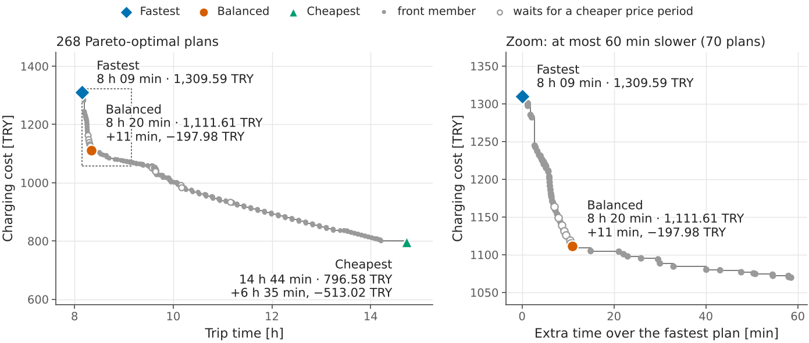

<div align="center">

# EVRoute

**Exact, battery-, queue- and degradation-aware route planning for electric vehicles with charging stations.**


*Where to charge, how much, at what speed and when to leave - computed with provably optimal algorithms, checked by an independent evaluator, and animated in your browser.*

Pure Python ≥ 3.10 · zero runtime dependencies · MIT licence<br>
**English** · [Türkçe](README.tr.md) · [Documentation](docs/index.md) · [Guide](docs/guide.md) · [Model](docs/model.md) · [Algorithms & proofs](docs/algorithms.md)

</div>

---

## Why EVRoute?

Electric-vehicle route planning is "a solved problem" - until you list what a
real trip involves. Most tools handle one or two of these effects and
simplify the rest away:

| Effect | In reality | EVRoute |
|---|---|---|
| Nonlinear charging | power drops sharply above ~50-80 % SoC | exact charging curves per vehicle × charger |
| Partial charging | stop at 54 %, not at 100 % | continuous amounts (CFP) or a fine grid (BLS) |
| Queues | 20-40 min at busy service areas in the afternoon | Erlang-C queues with hourly demand |
| Terrain and cold | descents refill the battery; −5 °C: smaller battery, slower charging | physics model with grade, wind and regeneration; cold-weather capacity and charging |
| Battery wear | fast charging at high SoC ages the pack | priced in the objective |
| Prices | dearer above 80 % SoC and at peak hours | tariffs, with exact planning of when to wait |
| Uncertainty | consumption deviates ±10 % | Monte Carlo reliability, safety factor |

EVRoute puts **all of them into one exact model**, solves it with algorithms
that come with optimality proofs and verifies every answer with an
independent replay - a **reference implementation** that heuristics, learned
models and commercial planners can be measured against. The full list of
effects: [`docs/model.md`](docs/model.md#at-a-glance).

## Highlights

- **9 planners behind one API** - from a battery-blind fastest path and an
  "in-car navigator" heuristic to exact label setting (BLS, BLS-A\*), exact
  continuous charging (CFP, CFP-A\*) and a Pareto search over time, money
  and battery wear.
- **Exact and verified** - continuous energies, exact charging curves,
  [optimality proofs](docs/algorithms.md); every plan is replayed by an
  independent evaluator and cross-checked against brute force.
- **No single best route** - charging tariffs with the 80 % rule and peak
  hours, and exact planning of when it pays to wait for a cheaper price
  ([below](#there-is-no-single-best-route)).
- **See it** - an animated, offline web viewer (trip, race and search-replay
  modes, TR/EN, light/dark, mobile), a live planning server and an
  interactive experiment dashboard.
- **Turkey case study** - 1 279 nodes, 146 roads, 10 mountain passes and 290
  synthetic charging stations; plus synthetic networks of up to 40 000 nodes
  and an OpenStreetMap loader.
- **Reproducible** - eleven seeded experiments behind every table and
  figure, one command; a [gentle guide](docs/guide.md) to the algorithms.

## Screenshots

<table>
<tr>
<td width="50%"><br><sub><b>Trip mode.</b> Every algorithm's route on a hill-shaded map; the selected plan with its stops, queue, charging and costs.</sub></td>
<td width="50%"><br><sub><b>Search replay.</b> The same optimum, two searches: BLS-A* (top) settles a narrow corridor, Dijkstra-order BLS (bottom) floods the country.</sub></td>
</tr>
<tr>
<td width="50%"><br><sub><b>Charts.</b> SoC over distance with elevation, 24 h queue profile, time breakdown, time-vs-money Pareto front and a sortable comparison table.</sub></td>
<td width="50%"><br><sub><b>Results dashboard.</b> All experiments in one offline page with computed findings, exactness checks, tables and CSV downloads.</sub></td>
</tr>
</table>

<details>
<summary><b>More: dark theme, charging animation, seaborn figures</b></summary>

<p align="center">


</p>
<p align="center">


</p>
<p align="center">

</p>
<p align="center">

</p>
<p align="center">


</p>
</details>

## Quick start

```bash
git clone https://github.com/Aseloth99/evroute.git
cd evroute
pip install -e .            # the planner: no dependencies at all
pip install -e ".[plot]"    # optional: seaborn for static figures
```

### Command line

```bash
evroute scenarios                                    # list the preset scenarios
evroute plan turkey-karaman-istanbul                 # plan with BLS-A* (default)
evroute plan turkey-karaman-istanbul-tariff --objective cost      # 80 % rule + peak hours: waits for 20:00
evroute viz turkey-karaman-istanbul -o karaman-istanbul.html --lang en   # animated viewer, works offline
evroute serve turkey-karaman-istanbul --open          # live planning in the browser
evroute experiments --quick -o results/               # all eleven experiments, smoke size (~1.5 min)
```

```text
$ evroute plan turkey-karaman-istanbul
[bls-astar] 8 h 07 min | 747.27 km | 2 stop(s) | arrive 10.4% | 1138.78 TRY
#  station     charger    arrive  queue  charge  SoC         cost
-  ----------  ---------  ------  -----  ------  ----------  ----------
1  Akşehir DC  DC 120 kW   10:20  3 min  11 min  28% -> 54%  336.73 TRY
2  Kütahya DC  DC 150 kW   12:28  3 min  25 min  10% -> 72%  802.05 TRY
arrival 16:06 | drive 7 h 19 min | charge 36 min | queue+setup 12 min | battery wear 0.0188 %SoH
```

Every command and option (origin, destination, SoC, departure, temperature,
vehicle, tariff, ...): [documentation](docs/index.md#command-line), or
`evroute <command> -h`.

### Python

```python
from evroute import plan
from evroute.generators.presets import get_scenario
from evroute.robustness import monte_carlo

scenario = get_scenario("turkey-karaman-istanbul")
route = plan(scenario, "bls-astar")  # exact on the charging-target grid
print(route)

# What if?  Treat a scenario as immutable: with_* returns a modified copy.
print(plan(scenario.with_conditions(temperature_c=-5), "cfp-astar"))   # winter, continuous charging
print(plan(scenario.with_preferences(objective="cost"), "bls-astar"))  # time + money + battery wear

# The time-money trade-off (a label budget keeps it interactive)
front = plan(scenario, "pareto", criteria=("time", "money"), max_labels=1_000_000)
print(len(front.alternatives), "Pareto-optimal routes; complete:", front.stats.extra["complete"])

# How often does the plan fail when consumption and queues are random?
mc = monte_carlo(scenario.prepare(), route, n=2000, seed=0)
print(f"P(strand) = {mc.p_strand:.2%}   P(reserve breach) = {mc.p_reserve_breach:.1%}")
```

```text
[bls-astar] 8 h 07 min | 747.27 km | 2 stop(s) | arrive 10.4% | 1138.78 TRY
[cfp-astar] 8 h 23 min | 747.27 km | 3 stop(s) | arrive 10.0% | 1669.75 TRY
[bls-astar] 8 h 15 min | 747.27 km | 2 stop(s) | arrive 10.5% | 1092.91 TRY
32 Pareto-optimal routes; complete: False
P(strand) = 0.40%   P(reserve breach) = 51.9%
```

The last line is the point of the robustness module: a plan that is optimal
for the *expected* consumption arrives with barely more than the 10 % reserve
(10.4 %), so half of all random worlds dip below it. Plan with
`safety_factor` > 1 (`--safety`) to buy reliability with minutes - see
[the robustness experiment](#experiments). Your own road network, vehicle
and chargers, or OpenStreetMap data:
[documentation](docs/index.md#your-own-network-vehicle-and-chargers).

## Example: Karaman → İstanbul

747 km across the Konya plateau and the Afyon-Kütahya-Bursa corridor, a
Turkish C-SUV (85 kWh battery) leaving at 08:00 with 80 %, 10 % reserve on
the way and on arrival, expected queues at every charger. Runtimes are the
median of five runs of the planner alone on a 2.1 GHz Xeon core (Python
3.13); the gap is measured against the continuous optimum of CFP:

| algorithm | trip time | gap | stops | charging cost [TRY] | arrival SoC | labels settled | runtime |
|---|---:|---:|---:|---:|---:|---:|---:|
| `naive` | stranded at 364 km | | 0 | | −77.2 % | 887 | 1 ms |
| `greedy` | 8:30:51 | +4.97 % | 2 | 1,659.68 | 47.1 % | 2,076 | 9 ms |
| `station-graph` | 9:19:35 | +14.98 % | 2 | 1,180.77 | 17.0 % | 14 | 61 ms |
| `genetic` | 8:08:28 | +0.37 % | 2 | 1,175.32 | 10.0 % | 754 | 244 ms |
| `bls` | 8:06:56 | +0.05 % | 2 | 1,138.78 | 10.4 % | 42,980 | 258 ms |
| **`bls-astar`** | **8:06:56** | +0.05 % | 2 | 1,138.78 | 10.4 % | **1,491** | **38 ms** |
| `cfp` | 8:06:41 | 0 | 2 | 1,133.96 | 10.0 % | 5,665 | 383 ms |
| **`cfp-astar`** | **8:06:41** | 0 | 2 | 1,133.96 | 10.0 % | **347** | **27 ms** |

- **The battery-blind route strands** after 364 km; the greedy "charge to
  80 % when needed" heuristic is 24 minutes slower and 46 % more expensive.
- **Partial charging is the whole game:** the optimum stops briefly at
  Akşehir (28 → 54 %) and longer at Kütahya (10 → 72 %), arriving with
  exactly the required 10 %.
- **A\* pays off:** BLS-A\* settles 29× fewer labels than BLS (CFP-A\*: 16×
  fewer than CFP) and returns the identical optimum.
- BLS, restricted to a 2 % SoC grid, is only 15.6 s behind the continuous
  optimum of CFP.

> [!IMPORTANT]
> The Turkey data is **approximate and illustrative, not for navigation**:
> gazetteer-level geography, modelled road lengths and **synthetic charging
> stations, prices, queues and tariff** with generic operator names. Use it
> to compare algorithms, not to plan a real trip
> ([data provenance](docs/index.md#turkey-case-study)).

## There is no single best route

A trip costs three things - **time**, **money** and **battery wear** - and
they pull in different directions. Charging prices make the trade-off
sharper; EVRoute models two common practices with a `Tariff`:

- **The 80 % rule.** Above about 80 % SoC the charging power drops steeply,
  so operators charge more for every kWh stored above `high_soc`.
- **Peak hours.** At busy times of day a peak factor applies - on fixed
  clock hours, or whenever a station's queue model expects it to be busy.

The price is fixed when you join the queue, so waiting for a cheaper price
can pay; EVRoute plans such *voluntary holds* exactly, and only where they
pay. The preset `turkey-karaman-istanbul-tariff` is the trip above leaving
at 14:00 under the illustrative demonstration tariff (×1.3 above 80 % SoC,
a 16:00-20:00 peak at ×1.15, ×2.3 above 80 % in the peak):

<p align="center"></p>

| plan | trip time | charging cost | battery wear | what it does |
|---|---:|---:|---:|---|
| fastest (`bls-astar`) | 8 h 09 min | 1,309.59 TRY | 0.0188 %SoH | Akşehir 28 → 54 % and Kütahya 10 → 72 %, both in the peak; the same stops cost 1,138.78 TRY at flat prices (+15 %) |
| balanced (`--objective cost`) | 8 h 20 min | 1,111.61 TRY | 0.0182 %SoH | Ilgın 39 → 85 %, joining the queue at 15:52, before the peak; İnegöl 10 → 52 % after waiting 2.4 min for 20:00 |
| cheapest (end of the front) | 14 h 44 min | 796.58 TRY | 0.0162 %SoH | three slow 22 kW AC stops, never above 80 %; the first joins at 15:52 and charges for 3 h 09 min at the off-peak price |

No plan wins on every count, and the first minutes buy the most: 11 minutes
more save 197.98 TRY (−15.1 %), the next 6 h 24 min only 315.04 TRY more.
The Pareto search finds all 268 plans of the front; which one is right
depends on what an hour is worth to you.

```bash
evroute plan turkey-karaman-istanbul-tariff --objective cost   # the balanced plan
```

Step by step in the [guide](docs/guide.md#11-tariffs-there-is-no-single-best-route);
the model in [`docs/model.md` §5](docs/model.md#5-charging-tariffs); the
full worked example (CLI output, the Pareto search in Python, a whole day of
departures) in the [documentation](docs/index.md#worked-example).

## Algorithms

| name | idea | guarantee |
|---|---|---|
| `naive` | fastest path, battery ignored | none |
| `greedy` | in-car navigator: detour to a charger when the battery is short, charge to 80 % (DC) / 100 % (AC) | heuristic |
| `station-graph` | Dijkstra over the stations, fixed charging target | optimal on its meta-graph |
| `genetic` | seeded genetic algorithm over stations and target SoCs | heuristic |
| `bls` | label setting over (node, energy), Dijkstra order | **exact** on the charging grid |
| `bls-astar` | BLS + a consistent A\* potential (default) | same optimum as `bls`, far fewer labels |
| `cfp` | charging-function propagation: continuous charging amounts | **exact** fastest route |
| `cfp-astar` | CFP with the A\* key | same optimum as `cfp` |
| `pareto` | multi-criteria label setting over time, money, wear | **exact** Pareto front on the grid |

The exact planners minimise the trip time or a generalised cost of time,
money and wear (CFP: time only) and handle time-dependent queues, eco
speeds, regeneration and tariffs. How they work: the [guide](docs/guide.md) (step by step, ending
with "[which planner should I use?](docs/guide.md#12-which-planner-should-i-use)")
and [`docs/algorithms.md`](docs/algorithms.md#at-a-glance) (overview and proofs).

## Experiments

Eleven seeded experiments reproduce every table and figure of the
accompanying paper. Each writes CSV, JSON, figures and LaTeX tables; the run
ends with `results.html`, an interactive offline dashboard.

```bash
evroute experiments --quick -o results/            # smoke size: ~1.5 minutes
evroute experiments -o results/ --lang en          # full size, English dashboard
evroute gallery -o docs/img                        # the seaborn figures of this README
```

| experiment | finding |
|---|---|
| `optimality-gap` | 60 random trips ≥ 300 km, gap to the continuous optimum: greedy 5.2 % on average, station graph 12.8 %, genetic 0.75 %, BLS-A\* on its 2 % grid 0.11 % |
| `queue-awareness` | planning with the expected queues saves 3.4 min on average and up to 21.7 min against a queue-blind plan |
| `temperature` | Karaman → İstanbul: 8 h 07 min at 20 °C, 8 h 37 min at −15 °C with a preconditioned battery, 10 h 24 min without |
| `robustness` | İzmir → Erzurum: P(reserve breach) 56 % at safety factor 1.0, 9.7 % at 1.1 (+21 min), 0.4 % at 1.2 (+36 min) |
| `tariffs` | the cost-optimal plan pays 76.73 TRY (7.6 %) less than the fastest for 6.3 min more |
| `scalability` | synthetic countries of 40 000 nodes: BLS-A\* answers in 1.7 s and CFP-A\* in 2.5 s on average |

All eleven findings, the outputs and the run times:
[documentation](docs/index.md#experiments-and-figures).

## How correctness is verified

Every plan of every planner is replayed by an **independent evaluator**; a
seeded **cross-validation suite** checks eleven invariants against brute
force, analytic oracles, metamorphic relations and local search, also under
random charging tariffs ([`tests/fuzz_report.md`](tests/fuzz_report.md)).
634 tests, 541 in the fast tier, run on Python 3.10-3.13 in CI
([details](docs/algorithms.md#8-how-correctness-is-verified)):

```bash
python -m pytest -m "not slow"   # fast tier, a few minutes
```

## Documentation

- [Guide](docs/guide.md) ([Türkçe](docs/guide.tr.md)) - the algorithms step
  by step, for newcomers, and "which planner should I use?"
- [Model](docs/model.md) - every equation, with the module that implements it
- [Algorithms & proofs](docs/algorithms.md) - correctness arguments and references
- [Documentation index](docs/index.md) - command line, Python API, viewer,
  live server, experiments, scenarios and data, tariffs, FAQ, roadmap
- Demo pages (one offline HTML file each): [viewer](docs/demo/index.html),
  [tariff viewer](docs/demo/tariff.html), [results dashboard](docs/demo/results.html)
- [Contributing](CONTRIBUTING.md) - set-up, project structure, ground rules

## Citation

If EVRoute helps your research, please cite it ([`CITATION.cff`](CITATION.cff)):

```bibtex
@software{acik_evroute_2026,
  author  = {Açık, Mustafa},
  title   = {{EVRoute}: exact, battery-, queue- and degradation-aware route planning
             for electric vehicles with charging stations},
  version = {1.0.0},
  year    = {2026},
  url     = {https://github.com/Aseloth99/evroute},
  license = {MIT}
}
```

## Licence

[MIT](LICENSE) © 2026 Mustafa Açık, Karamanoğlu Mehmetbey University,
Department of Computer Engineering.

## Acknowledgements

- The algorithms build on the work of Artmeier et al. (2010), Storandt &
  Funke (2012), Baum, Dibbelt, Gemsa, Wagner & Zündorf (2015, 2019), Baum,
  Dibbelt, Wagner & Zündorf (2020),
  Montoya et al. (2017), Martins (1984) and Mandow & Pérez de la Cruz
  (2010) - full references in [`docs/algorithms.md`](docs/algorithms.md#references).
- Place coordinates and elevations of the Turkey case study were compiled
  at gazetteer level from general geographic knowledge; no proprietary map
  or charging-network data is included. The optional OSM loader uses
  [OSMnx](https://github.com/gboeing/osmnx) and
  [OpenStreetMap](https://www.openstreetmap.org/copyright) data (© OpenStreetMap
  contributors, ODbL) when you choose to download it.
