<div align="center">

# EVRoute

**Elektrikli araçlar için bataryayı, şarj kuyruklarını ve batarya yıpranmasını hesaba katan, şarj istasyonlu kesin rota planlama.**

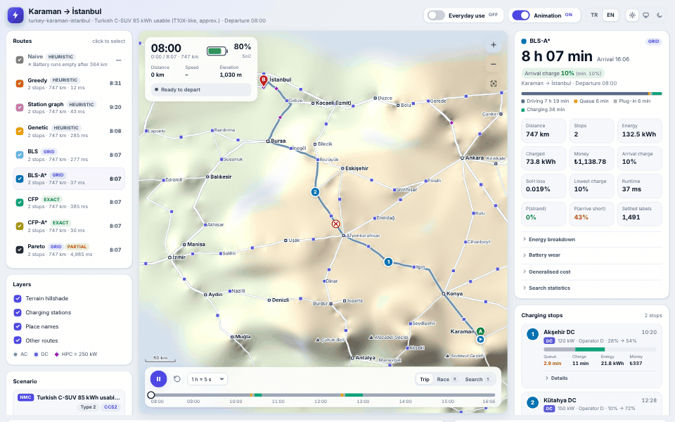

*Nerede ve ne kadar şarj edeceğiniz, hangi hızla gideceğiniz, ne zaman yola çıkacağınız — hepsi optimallikleri ispatlanmış algoritmalarla hesaplanır, bağımsız bir değerlendiriciyle denetlenir ve tarayıcınızda canlandırılır.*

Saf Python ≥ 3.10 · çalışma zamanında sıfır bağımlılık · MIT lisansı<br>
[English](README.md) · **Türkçe** · [Dokümantasyon](docs/index.md) · [Model](docs/model.md) · [Algoritmalar ve ispatlar](docs/algorithms.md)

</div>

---

## Neden EVRoute?

Elektrikli araçlar için rota planlama "çözülmüş bir problem" gibi görünür — ta
ki gerçek bir yolculuğun neleri kapsadığını tek tek sıralayana kadar.
Çalışmaların ve yazılımların çoğu bu etkilerin bir ya da ikisini ele alır,
gerisini basitleştirip geçer:

| Etki | Gerçekte | Yaygın basitleştirme | EVRoute |
|---|---|---|---|
| Doğrusal olmayan şarj | SoC ~%50-80'i geçince güç keskin biçimde düşer | sabit güç | her araç × şarj ünitesi çifti için kesin, parçalı doğrusal şarj fonksiyonları |
| Kısmi şarj | şarj %100'de değil, %54'te kesilir | hep tam doluma / sabit bir hedefe kadar şarj | sürekli şarj miktarları (CFP) ya da ince bir hedef ızgarası (BLS) |
| Kuyruklar | öğleden sonraları yoğun dinlenme tesislerinde 20-40 dk | bekleme yok | saatlik talep profilli Erlang-C M/M/c kuyrukları; zamana bağlı ve FIFO-güvenli |
| Arazi ve rejeneratif frenleme | inişler bataryayı yeniden doldurur | düz yollar | eğim, rüzgâr, dur-kalk, geri kazanım sınırı ve batarya doluyken geri kazanımın kesilmesini içeren fizik modeli |
| Sıcaklık | −5 °C'de kullanılabilir kapasite küçülür, ısıtma gerekir, şarj yavaşlar | 20 °C | kullanılabilir kapasite, HVAC yükü, soğukta şarj gücü düşümü, batarya ön ısıtması |
| Batarya yıpranması | yüksek SoC'de hızlı şarj batarya paketini yaşlandırır | yok sayılır | C-oranı, SoC ve sıcaklığa bağlı SoH kaybı; amaç fonksiyonunda fiyatlandırılır |
| Belirsizlik | tüketim ±%10 sapar | deterministik | Monte Carlo güvenilirlik analizi, güvenlik katsayısı, uyarlanabilir sürücü politikası |
| Eko-sürüş | daha yavaş sürmek bir şarj molasını kaldırabilir | tek hız | her yol için birden çok hız seviyesi |

EVRoute bunların **hepsini tek bir kesin modelde** birleştirir; modeli
optimallik ispatlarıyla birlikte gelen algoritmalarla çözer, her yanıtı
bağımsız bir yeniden simülasyonla doğrular ve sonucu animasyonlu, çevrimdışı
çalışan bir web görüntüleyicide somut hâle getirir. Bir **referans uygulama**
olarak tasarlanmıştır: diğer yöntemlerin (sezgiseller, öğrenen modeller,
ticari planlayıcılar) kendisiyle kıyaslanabileceği bir temel çizgi.

## Öne çıkanlar

- **Tek API ardında 9 planlayıcı** — bataryayı hesaba katmayan en hızlı yoldan
  ve "araç içi navigasyon" sezgiselinden; kesin etiket ayarlamaya (label
  setting; BLS, BLS-A\*), kesin sürekli şarja (CFP, CFP-A\*) ve süre, para ve
  batarya yıpranması üzerinde çok ölçütlü bir Pareto aramasına kadar.
- **Kesin, gerçekten kesin** — sürekli enerjiler (tüketim hiçbir zaman
  yuvarlanmaz), kesin şarj eğrileri, aynı istasyondaki farklı şarj
  ünitelerinde art arda molalar; optimallik ispatları
  [`docs/algorithms.md`](docs/algorithms.md) dosyasında.
- **Yalnızca test edilmiş değil, doğrulanmış** — her planlayıcının her planı
  bağımsız bir değerlendirici tarafından yeniden simüle edilir; sabit tohumlu
  bir çapraz doğrulama paketi 11 değişmezi kaba kuvvete, metamorfik
  bağıntılara ve yerel aramaya karşı sınar
  ([`tests/fuzz_report.md`](tests/fuzz_report.md)).
- **Gerçek bir uygulama** — animasyonlu, tek dosyalık bir web görüntüleyici
  (yolculuk, yarış ve arama tekrarı modları; TR/EN; açık/koyu tema; mobil
  uyum), canlı bir planlama sunucusu (haritaya tıklayın, *Planla*'ya basın),
  etkileşimli bir deney paneli ve yayın kalitesinde seaborn grafikleri.
- **Türkiye vaka çalışması** — 1 279 düğüm, 146 yol, 10 dağ geçidi ve 290
  sentetik şarj istasyonundan oluşan yaklaşık bir şehirlerarası ağ; buna ek
  olarak sentetik ağ üreteçleri (40 000 düğüme kadar) ve bir OpenStreetMap
  yükleyicisi.
- **Tekrarlanabilir deneyler** — her tablonun ve grafiğin arkasında on deney;
  tek komut, sabit tohum, CSV + JSON + LaTeX + grafikler.
- **Sıfır bağımlılık** — çekirdek yalnızca standart kütüphaneyle yazılmış
  Python'dur; `matplotlib`/`seaborn` isteğe bağlıdır ve yalnızca statik
  grafikler için kullanılır.

## Ekran görüntüleri

<table>
<tr>
<td width="50%">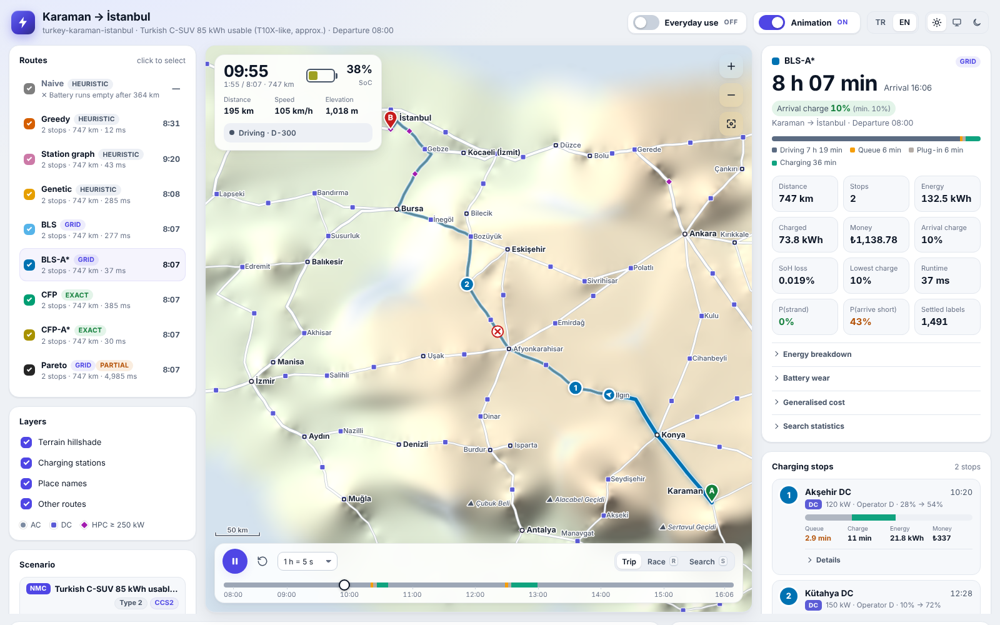<br><sub><b>Yolculuk modu.</b> Her algoritmanın rotası rölyef gölgelendirmeli bir haritada; seçili plan durakları, kuyruğu, şarjı ve maliyetleriyle birlikte.</sub></td>
<td width="50%">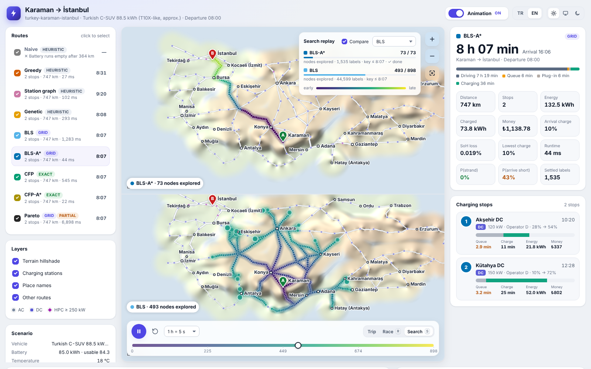<br><sub><b>Arama tekrarı.</b> Aynı optimum, iki ayrı arama: BLS-A* (üstte) yalnızca dar bir koridoru kesinleştirirken Dijkstra sırasıyla ilerleyen BLS (altta) bütün ülkeye yayılır.</sub></td>
</tr>
<tr>
<td width="50%">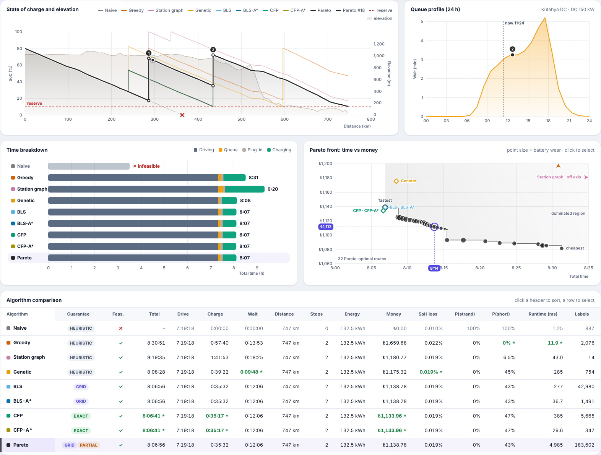<br><sub><b>Grafikler.</b> Rakım profiliyle birlikte mesafeye göre SoC, 24 saatlik kuyruk profili, süre dağılımı, süre–para Pareto cephesi ve sıralanabilir bir karşılaştırma tablosu.</sub></td>
<td width="50%">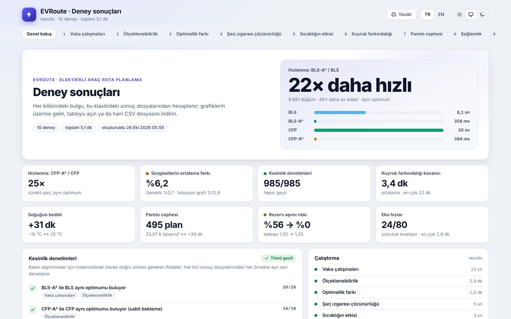<br><sub><b>Sonuç paneli.</b> Tüm deneyler tek bir çevrimdışı sayfada: hesaplanmış bulgular, kesinlik denetimleri, tablolar ve CSV indirmeleri.</sub></td>
</tr>
</table>

<details>
<summary><b>Daha fazlası: koyu tema, şarj animasyonu, mobil görünüm, seaborn grafikleri</b></summary>

<p align="center">
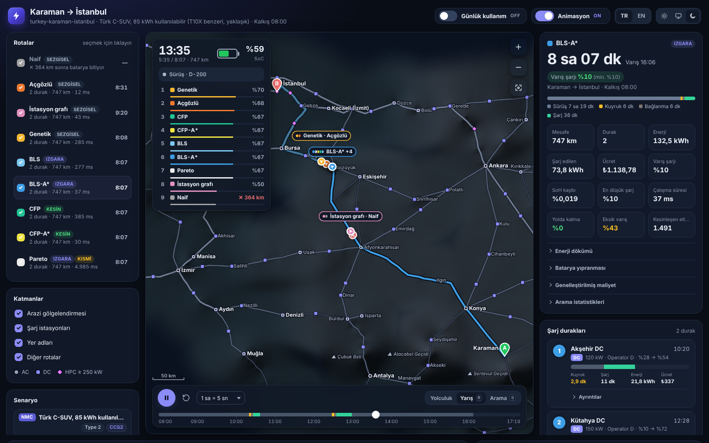
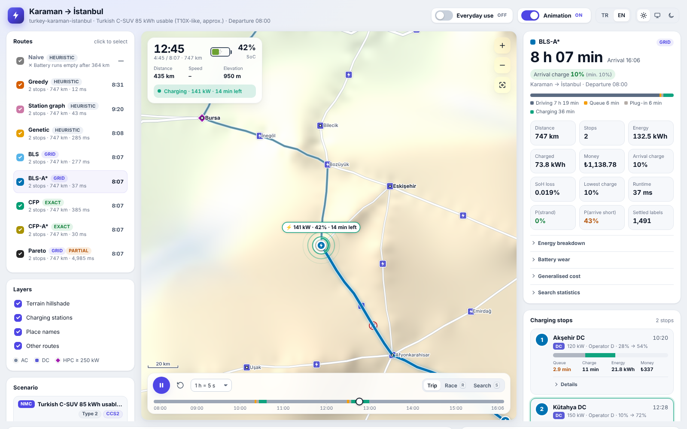
</p>
<p align="center">
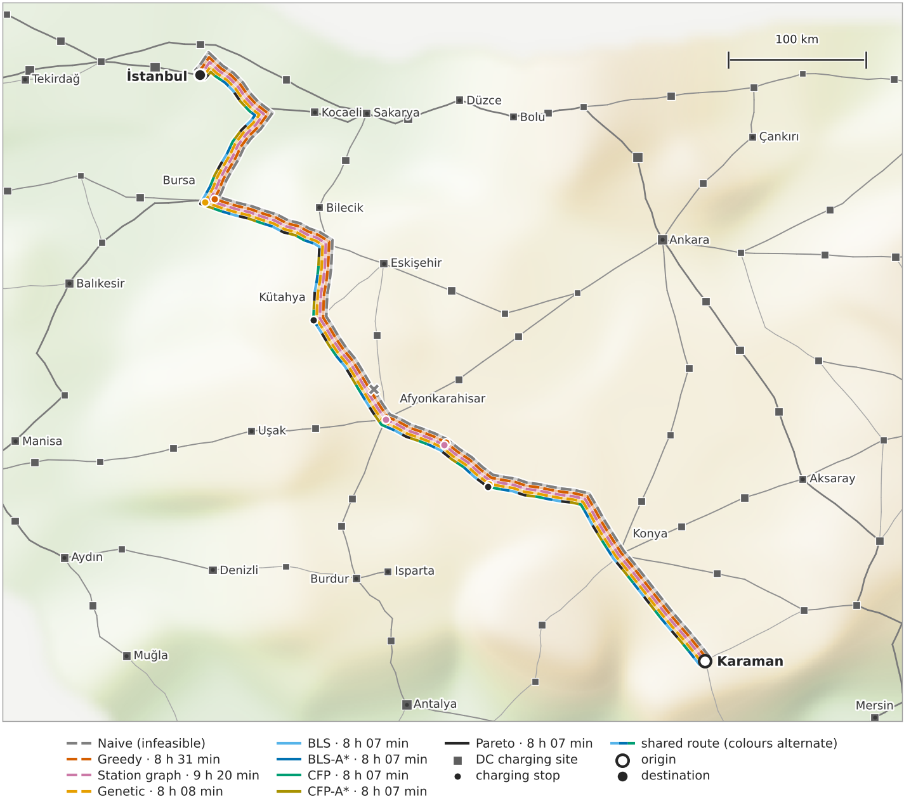
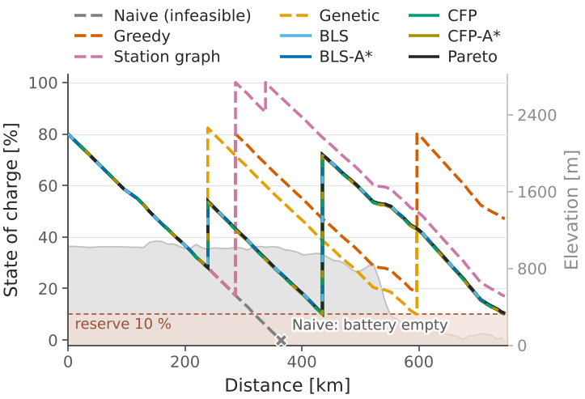
</p>
<p align="center">
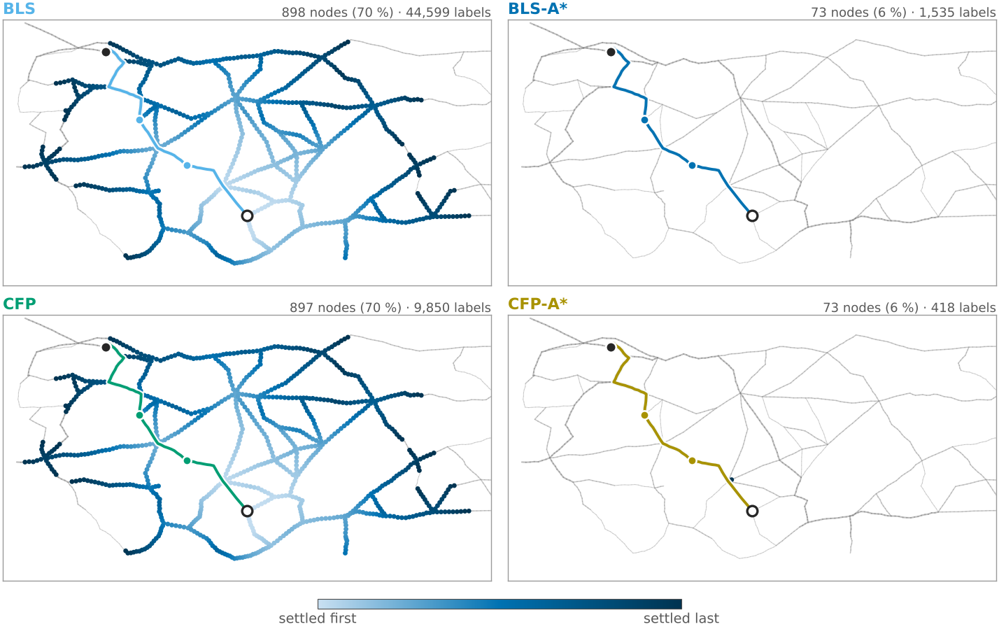
</p>
<p align="center">
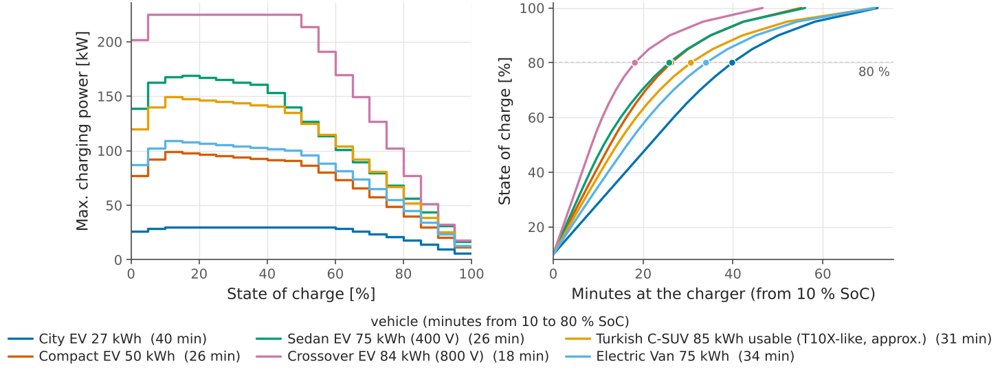
</p>
<p align="center">
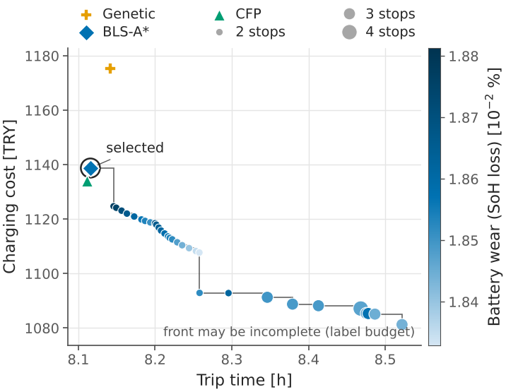
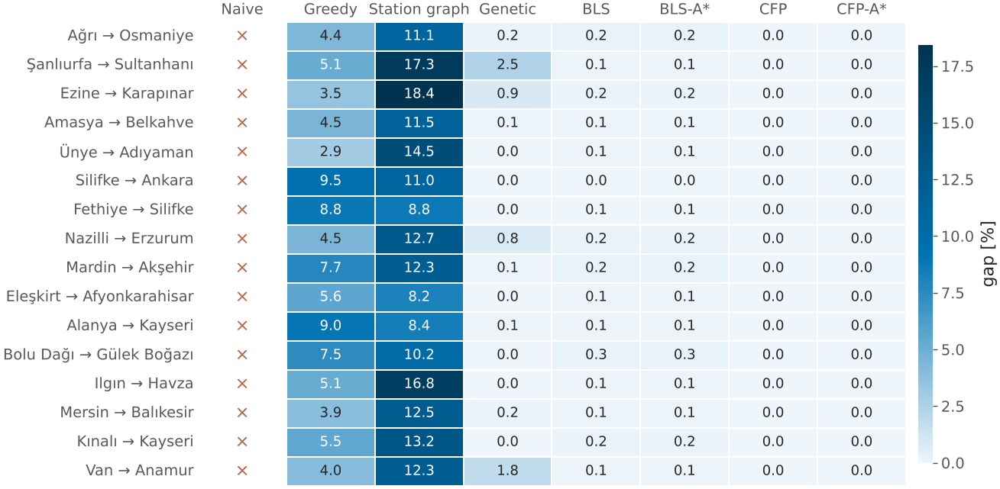
</p>

Tüm statik grafikler `evroute gallery -o docs/img` ile, ekran görüntüleri ve
GIF ise `python examples/viewer_demo.py --screenshots docs/img` ile yeniden
üretilir (Node.js ve Playwright gerekir).
</details>

## Hızlı başlangıç

```bash
git clone https://github.com/Aseloth99/evroute.git
cd evroute
pip install -e .            # planlayıcı: hiçbir bağımlılığı yok
pip install -e ".[plot]"    # isteğe bağlı: statik grafikler için matplotlib + seaborn
pip install -e ".[dev]"     # isteğe bağlı: + pytest
```

### Komut satırı

```bash
evroute scenarios                                    # hazır senaryoları listeler
evroute algorithms                                   # planlayıcıları ve garantilerini listeler
evroute plan turkey-karaman-istanbul                 # BLS-A* ile planlar (varsayılan)
evroute plan turkey-karaman-istanbul --from Konya --to Ankara --soc 0.35 -a cfp
evroute compare turkey-karaman-istanbul --algorithms naive,greedy,station-graph,genetic,bls,bls-astar,cfp,cfp-astar
evroute viz turkey-karaman-istanbul -o karaman-istanbul.html --lang en   # animasyonlu görüntüleyici, çevrimdışı çalışır
evroute serve turkey-karaman-istanbul --open          # tarayıcıda canlı planlama
evroute robustness turkey-izmir-erzurum -n 2000 --safety 1.1             # Monte Carlo güvenilirliği
evroute experiments --quick -o results/               # on deneyin tamamı, hızlı boyut (~1 dk)
```

```text
$ evroute plan turkey-karaman-istanbul
[bls-astar] 8 h 07 min | 747.27 km | 2 stop(s) | arrive 10.4% | 1138.78 TRY
#  station     charger    arrive  queue  charge  SoC         cost
-  ----------  ---------  ------  -----  ------  ----------  ----------
1  Akşehir DC  DC 120 kW   10:20  3 min  11 min  28% -> 54%  336.73 TRY
2  Kütahya DC  DC 150 kW   12:28  3 min  25 min  10% -> 72%  802.05 TRY
arrival 16:06 | drive 7 h 19 min | charge 36 min | queue+setup 12 min | battery wear 0.0188 %SoH
```

Senaryo komutları (`plan`, `compare`, `viz`, `robustness`, `figures`,
`export-scenario`) bir hazır senaryo adı ya da bir senaryo `.json` dosyası
(`evroute export-scenario ... -o my.json`) alır; senaryonun değerleri
`--from --to --soc --depart --temp --vehicle --objective --reserve --arrive --eco --no-queue --step --safety`
seçenekleriyle geçersiz kılınabilir. `serve` yalnızca hazır senaryo adı alır.
Seçeneklerin tamamını `evroute <command> -h` listeler.

### Python

```python
from evroute import plan
from evroute.generators.presets import get_scenario
from evroute.robustness import monte_carlo

scenario = get_scenario("turkey-karaman-istanbul")
route = plan(scenario, "bls-astar")  # şarj hedefi ızgarasında kesin
print(route)
for s in route.stops:
    print(f"  {s.station_name:12} {s.soc_in:4.0%} -> {s.soc_out:4.0%}"
          f"  queue {s.wait_s / 60:2.0f} min  charge {s.charge_s / 60:2.0f} min")

# Ya koşullar değişirse? Senaryoyu değiştirmeyin; with_* değiştirilmiş bir kopya döndürür.
print(plan(scenario.with_conditions(temperature_c=-5), "cfp-astar"))   # kış, sürekli şarj
print(plan(scenario.with_preferences(objective="cost"), "bls-astar"))  # süre + para + batarya yıpranması

# Süre–para ödünleşimi (etiket bütçesi aramayı etkileşimli hızda tutar)
front = plan(scenario, "pareto", criteria=("time", "money"), max_labels=1_000_000)
print(len(front.alternatives), "Pareto-optimal routes; complete:", front.stats.extra["complete"])

# Tüketim ve kuyruklar rastgele olduğunda plan ne sıklıkla başarısız olur?
mc = monte_carlo(scenario.prepare(), route, n=2000, seed=0)
print(f"P(strand) = {mc.p_strand:.2%}   P(reserve breach) = {mc.p_reserve_breach:.1%}")
```

```text
[bls-astar] 8 h 07 min | 747.27 km | 2 stop(s) | arrive 10.4% | 1138.78 TRY
  Akşehir DC    28% ->  54%  queue  3 min  charge 11 min
  Kütahya DC    10% ->  72%  queue  3 min  charge 25 min
[cfp-astar] 8 h 23 min | 747.27 km | 3 stop(s) | arrive 10.0% | 1669.75 TRY
[bls-astar] 8 h 15 min | 747.27 km | 2 stop(s) | arrive 10.5% | 1092.91 TRY
32 Pareto-optimal routes; complete: False
P(strand) = 0.40%   P(reserve breach) = 51.9%
```

Son satır, sağlamlık modülünün neden var olduğunu özetliyor: *beklenen*
tüketime göre optimal olan bir plan hedefe %10'luk rezervin ancak biraz
üstünde (%10,4) varır;
dolayısıyla rastgele gerçekleşmelerin yarısında bu rezervin altına düşülür.
Birkaç dakika karşılığında güvenilirlik satın almak için `safety_factor` > 1
ile (komut satırında `--safety`) planlayın — bkz.
[sağlamlık deneyi](#deneyler).

<details>
<summary><b>Kendi yol ağınızı, aracınızı ve şarj istasyonlarınızı kullanın</b></summary>

```python
from evroute import (ChargingCurve, Conditions, NetworkBuilder, Preferences, Query,
                     Scenario, Station, Vehicle, plan)

b = NetworkBuilder()
a = b.add_node(0, 0, elevation=50, name="A")                  # x, y metre cinsinden
p = b.add_node(60_000, 5_000, elevation=900, name="Pass")
s = b.add_node(120_000, 0, elevation=300, name="Service area")
z = b.add_node(260_000, 0, elevation=20, name="Z")
for u, v in [(a, p), (p, s), (s, z)]:
    b.add_road(u, v, road_class="motorway")                   # varsayılan olarak çift yönlü
net = b.build()

car = Vehicle(key="my-car", name="My car", battery_kwh=40.0, mass_kg=1500,
              drag_coeff=0.28, frontal_area_m2=2.3, rolling_coeff=0.009,
              dc_curve=ChargingCurve.from_points([(0, 60), (0.5, 60), (0.8, 30), (1.0, 8)]))
scenario = Scenario(
    name="custom", network=net, vehicle=car,
    stations=[Station(id=0, node=s, power_kw=120, kind="DC", plugs=4, price_per_kwh=0.5)],
    query=Query(origin=a, destination=z, initial_soc=0.8),
    conditions=Conditions(temperature_c=10),
    preferences=Preferences(reserve_soc=0.1, min_arrival_soc=0.15),
)
for name in ["naive", "bls-astar", "cfp"]:
    print(plan(scenario, name))
```

```text
[naive] infeasible: reserve undercut at node 3 (position 3): -17.443 < 3.840 kWh; arrival energy -17.443 kWh below required 5.760 kWh; battery empty after 162.8 km
[bls-astar] 2 h 43 min | 260.43 km | 1 stop(s) | arrive 16.9% | 12.72 EUR
[cfp] 2 h 41 min | 260.43 km | 1 stop(s) | arrive 15.0% | 12.34 EUR
```

Gerçek veri: `evroute.generators.osm.load_osm("Karaman, Turkey")` bir
OpenStreetMap ağı indirir (isteğe bağlı `osmnx` paketi gerekir),
`stations_from_csv(path, network)` şarj istasyonu listenizi bu ağın üzerine
oturtur ve `scenario_from_osm(...)` bunlardan bir senaryo oluşturur.
`Scenario.save()` / `Scenario.load()` bir senaryoyu JSON üzerinden kayıpsız
olarak kaydedip geri yükler.
</details>

## Örnek: Karaman → İstanbul

Konya Ovası ve Afyon–Kütahya–Bursa koridoru boyunca 747 km: 85 kWh bataryalı
yerli bir C-SUV saat 08:00'de %80 şarjla yola çıkıyor; yol boyunca ve varışta
%10 rezerv korunuyor, her şarj noktasında beklenen kuyruklar hesaba katılıyor.
Sütunlar `evroute compare` çıktısındakilerle aynıdır; çalışma süreleri, 2,1
GHz'lik bir Xeon çekirdeğinde (Python 3.13) yalnızca planlayıcının ölçüldüğü
beş koşunun medyanıdır; açık ise CFP'nin sürekli optimumuna göre ölçülmüştür:

| algoritma | yolculuk süresi | açık | durak | şarj maliyeti [TRY] | varış SoC | kesinleşen etiket | çalışma süresi |
|---|---:|---:|---:|---:|---:|---:|---:|
| `naive` | 364 km sonra yolda kalır | | 0 | | −77.2 % | 887 | 1 ms |
| `greedy` | 8:30:51 | +4.97 % | 2 | 1,659.68 | 47.1 % | 2,076 | 9 ms |
| `station-graph` | 9:19:35 | +14.98 % | 2 | 1,180.77 | 17.0 % | 14 | 61 ms |
| `genetic` | 8:08:28 | +0.37 % | 2 | 1,175.32 | 10.0 % | 754 | 244 ms |
| `bls` | 8:06:56 | +0.05 % | 2 | 1,138.78 | 10.4 % | 42,980 | 258 ms |
| **`bls-astar`** | **8:06:56** | +0.05 % | 2 | 1,138.78 | 10.4 % | **1,491** | **38 ms** |
| `cfp` | 8:06:41 | 0 | 2 | 1,133.96 | 10.0 % | 5,665 | 383 ms |
| **`cfp-astar`** | **8:06:41** | 0 | 2 | 1,133.96 | 10.0 % | **347** | **27 ms** |

Tablonun gösterdikleri:

- **Bataryayı hesaba katmayan rota** 364 km sonra yolda kalır. "Gerektiğinde
  %80'e kadar şarj et" diyen açgözlü (greedy) sezgisel uygulanabilir bir plan
  üretir, ancak 24 dakika daha yavaş ve %46 daha pahalıdır: bataryayı şarj
  eğrisinin yavaş kısmında doldurur ve hedefe hiç ihtiyaç duymadığı %47'lik
  bir şarjla varır.
- **Asıl fark kısmi şarjda.** Optimal plan Akşehir'de kısa (%28 → %54),
  Kütahya'da daha uzun (%10 → %72) mola verir ve hedefe tam olarak gereken
  %10'la varır. %2'lik bir SoC ızgarasıyla sınırlı BLS, CFP'nin sürekli
  optimumunun 15,6 sn gerisinde kalır.
- **A\* karşılığını veriyor.** BLS-A\*, BLS'ye göre 29 kat daha az etiket
  kesinleştirir (CFP-A\*, CFP'ye göre 16 kat daha az) ve birebir aynı
  optimumu bulur; farkı yukarıdaki arama tekrarı ekran görüntüsünde
  görebilirsiniz.
- Üç ölçütlü Pareto araması bu 750 km'lik örnekte varsayılan 2 milyon
  etiketlik sınırdan fazlasına ihtiyaç duyar (bu durumda `evroute compare`,
  `pareto` için uygulanabilir çözüm bulunamadığını bildirir);
  `criteria=("time", "money")` ile 1 milyon etiketlik bir bütçe içinde 32
  baskın olmayan (non-dominated) rota döndürür ve sonucu "eksik olabilir"
  diye işaretler.

## Algoritmalar

| ad | fikir | garanti |
|---|---|---|
| `naive` | en hızlı yol, batarya yok sayılır | yok — bataryanın *nerede* bittiğini gösterir |
| `greedy` | araç içi navigasyon: en hızlı yolu izle; batarya yetmeyecekse, istasyona varış süresi ile hedefe kalan sürenin alt sınırının toplamı en küçük olan erişilebilir istasyona sap, %80'e (DC) / %100'e (AC) kadar şarj et, tekrarla | sezgisel |
| `station-graph` | istasyonlardan oluşan bir meta-graf üzerinde Dijkstra; her durakta sabit bir hedefe (varsayılan %100) kadar şarj edilir, duraklar arasındaki kesimlerde en yüksek hız seviyesi kullanılır (Storandt & Funke 2012 tarzı) | yalnızca kendi meta-grafı üzerinde optimal |
| `genetic` | istasyon dizileri ve hedef SoC değerleri üzerinde çalışan, deterministik ve sabit tohumlu bir genetik algoritma; bireyler kesin, "ancak yetecek kadar" enerji miktarlarıyla plana çözülür | sezgisel |
| `bls` | batarya ile genişletilmiş (düğüm, enerji) durum uzayında Dijkstra sırasıyla etiket ayarlama | ızgaradaki şarj hedefleri için **kesin** (%2 SoC + şarj eğrisi kırılma noktaları) |
| `bls-astar` | BLS + tutarlı bir enerji açığı A\* potansiyeli (varsayılan planlayıcı) | `bls` ile aynı optimum, çok daha az etiket |
| `cfp` | şarj fonksiyonu yayılımı (charging function propagation, Baum vd.): etiketler zamanın fonksiyonlarıdır, şarj miktarları sürekli kalır | keyfi şarj miktarlarıyla **kesin** en hızlı rota |
| `cfp-astar` | A\* anahtarıyla CFP | `cfp` ile aynı optimum |
| `pareto` | süre, para ve yıpranma üzerinde çok ölçütlü etiket ayarlama (Martins, NAMOA\* tarzı budama) | hedef ızgarası üzerinde **kesin** Pareto cephesi |

Kesin planlayıcılar yolculuk süresini ya da `VoT·T + money + w·wear`
genelleştirilmiş maliyetini (VoT: zamanın parasal değeri) en küçükler (BLS,
BLS-A\*, Pareto; CFP yalnızca süreyi amaçlayan bir algoritmadır). Hepsi
zamana bağlı kuyrukları, birden çok hız seviyesini, rejeneratif frenlemeyi ve
aynı istasyondaki farklı şarj ünitelerinde art arda molaları destekler.

<details>
<summary><b>BLS-A* nasıl çalışır?</b></summary>

Bir *etiket*, `(t, e)` ile özetlenen kısmi bir rotadır: bir düğümdeki
yolculuk süresi ve batarya enerjisi; enerji **sürekli** tutulur. Bir kenardan
geçmek durumu `(v, e) → (w, min(e − c, Q))` biçiminde değiştirir; `j`
istasyonunda `y` hedefine kadar şarj etmek, kesin şarj fonksiyonu `F_j` ile
`wait_j(t) + setup_j + F_j(y) − F_j(e)` saniye sürer. Aynı düğümdeki bir
etiket, diğerinden daha geç değilse ve daha az enerjiye sahip değilse onu
baskılar (maliyet amacında para ve yıpranma da karşılaştırmaya girer). Her
geçiş monotondur ve kuyruklar FIFO özelliğini sağlar; bu nedenle baskılanan
etiketleri budamak kesinliği bozmaz.

A\* anahtarı `t + h(v, e)`'dir; burada

```
h(v, e) = T_lb(v) + (3600 / P_max) · max(0, E_lb(v) + e_goal − e)   [+ kaçınılmaz durak ek süresi]
```

yani kalan en kısa sürüş süresine, enerji açığını mümkün olan en yüksek güçle
şarj etmek için gereken süre eklenir. `h` batarya durum grafı üzerinde
tutarlıdır (enerji açığı bir yol boyunca küçülemez ve `ΔE` kadar şarj en az
`3600 ΔE / P_max` saniye sürer) ve `e`'ye göre artmayandır; bu yüzden baskın
etiket öncelik kuyruğundan her zaman önce çekilir ve hedefte çekilen ilk
etiket optimaldir. Varsayılan *sıkı* (tight) potansiyel, süreyi ve enerjiyi
aynı yol üzerinde ölçer ve kaçınılmaz durakları da hesaba katar. İspatlar:
[`docs/algorithms.md` §2-3](docs/algorithms.md#2-bls--battery-constrained-label-setting).
</details>

<details>
<summary><b>CFP nasıl çalışır? (sürekli şarj)</b></summary>

BLS, *ne kadar* şarj edileceğini bir ızgaraya bağlar. CFP ise bu kararı
erteler: bir etiket son istasyon `j`'yi, orada şarjın başladığı zamanı ve
enerjiyi ve o andan bu yana kat edilen yolun `(in, cost, out)` tüketim
profilini saklar. Etiketin *fonksiyonu* `B(t)` — araç `j`'den, mevcut düğüme
`t` anında varacak şekilde ayrılırsa bu düğümde elde bulunan enerji — parçalı
doğrusal ve azalmayan bir fonksiyondur. Bir kenar boyunca yalnızca profil
değişir (kapalı formda); yeni bir istasyonda ise etiket, `B`'nin kırılma
noktalarında durak etiketleri üretir: `j`'de şarj etmekten yeni istasyonda
şarj etmeye optimal geçiş tam da bu noktalardadır (Lemma 3; içbükey olmayan
eğrilerde gücün yükseldiği kırılmalar ve zamana bağlı beklemelerin düğüm
noktaları da eklenir). Baskınlık
sınaması, bir etiketi kendi düğümünde kesinleşmiş etiketlerin üst zarfıyla
karşılaştırır. Hedef için öncelik kuyruğundan çekilen ilk kayıt, **tüm** şarj
miktarları üzerinden en hızlı rotadır. İspatlar ve genişletmeler (konkav
olmayan eğriler, zamana bağlı kuyruklar, art arda duraklar):
[`docs/algorithms.md` §4](docs/algorithms.md#4-cfp--charging-function-propagation-continuous-charging).
</details>

## Tek ekranda model

- **Yol ağı** — koordinat, rakım, uzunluk, hız sınırı ve yol sınıfı (dur-kalk
  yoğunluğu) bilgisi taşıyan yönlü bir graf.
- **Sürüş** — boyuna dinamik: yuvarlanma direnci, karşı/arka rüzgâr ve hava
  yoğunluğunu içeren aerodinamik sürüklenme, eğim, dur-kalk kayıpları,
  yardımcı sistemler ve sıcaklığa bağlı HVAC gücü, verim ve güç sınırıyla
  rejeneratif frenleme; dolu bir bataryaya geri kazanılan enerji kaybolur.
  İsteğe bağlı hız seviyeleri (örn. %100/90/80).
- **Batarya** — kullanılabilir kapasite soğukta azalır; her düğümde rezerv
  SoC, minimum varış SoC'si, maksimum şarj SoC'si.
- **Şarj** — şarj ünitesinin gücüyle sınırlanan araç şarj eğrileri (SoC
  aralıklarında parçalı sabit güç) ve ön ısıtma yapılmamış soğuk bir
  bataryada düşürülen DC gücü → kesin, parçalı doğrusal şarj fonksiyonları
  (düşük SoC'deki güç artışının ötesinde içbükey/konkav; CFP iki biçimi de
  kesin olarak işler); şarj kayıplarını da içeren kWh başına
  fiyatlar; her mola için hazırlık süresi.
- **Kuyruklar** — her istasyon, saatlik talep profiline sahip bir M/M/c
  kuyruğudur; Erlang-C beklenen bekleme süresi, zamana bağlı planlamanın
  kesin kalması için FIFO-güvenli hâle getirilir.
- **Batarya yıpranması** — C-oranı, SoC ve sıcaklığın fonksiyonu olarak kWh
  başına SoH kaybı; SoH yüzde puanı başına fiyatlandırılır.
- **Amaçlar** — yolculuk süresi, genelleştirilmiş maliyet
  `VoT·T + w_money·money + w_wear·wear` ya da bu üçünün Pareto cephesi.
- **Belirsizlik** (değerlendirmede) — tüketim üzerinde log-normal yolculuk ve
  kenar çarpanları, üstel dağılımlı kuyruk gecikmeleri.

Tüm denklemler, onları gerçekleyen modüllerle birlikte:
[`docs/model.md`](docs/model.md).

## Türkiye vaka çalışması

`evroute.generators.turkey`, paketle birlikte gelen iki CSV tablosundan
**yaklaşık** bir Türkiye şehirlerarası ağı oluşturur: 171 yer (30 büyükşehir,
35 diğer il merkezi, 45 kavşak ve 47 ara nokta yerleşimi, Kop 2 409 m,
Alacabel 1 825 m ve Sertavul 1 610 m gibi 10 dağ geçidi ile 4 köprü) ve 146
otoyol ve devlet yolu bağlantısı (O-3 ... O-53, D-100, D-300, D-400, ...) —
toplam 1 279 düğüm, 2 632 kenar, ~14 100 km yol. Bunun üzerine Türk lirası
fiyatlı ve en yoğun dinlenme tesislerinde öğleden sonra kuyrukları kalibre
edilmiş, 290 istasyonluk (14'ü 300 kW HPC olmak üzere 199 DC ve 91 AC;
1 174 soket) **sentetik** bir şarj ağı kurulur.

| hazır senaryo | yolculuk |
|---|---|
| `turkey-karaman-istanbul` | 750 km: Konya Ovası, Afyon/Eskişehir koridorları, Marmara otoyolları (ana senaryo) |
| `turkey-antalya-ankara` | Akdeniz'den Toroslar üzerinden 530 km |
| `turkey-izmir-erzurum` | 1 470 km'lik batı-doğu geçişi, doğudaki dağlar |
| `turkey-istanbul-antalya-winter` | −5 °C'de 680 km |
| `turkey-karaman-mersin` | otoyol (273 km) ile Sertavul geçidi yolunun (254 km) karşılaştırması |
| `turkey-istanbul-ankara-rush` | 14:30'da, öğleden sonra kuyruklarının içine doğru yola çıkılan 450 km |
| `turkey-ankara-adana-evening` | 15:00'te yola çıkılan, O-21 boyunca 510 km |

Diğer hazır senaryolar: `corridor` / `corridor-winter` (1 500 m'lik bir geçit
içeren, kısmi şarjı sınayan 600 km'lik bir örnek), `country-small/-medium/-large`
(2 000-40 000 düğümlü sentetik ülkeler), `random-geometric`, `grid-small`.

> [!IMPORTANT]
> **Verilerin kaynağı — yaklaşıktır, örnekleme amaçlıdır, navigasyon için uygun değildir.**
> Koordinatlar ve rakımlar yer adları sözlüğü (gazetteer) düzeyinde yaklaşık
> değerlerdir (yaklaşık 1-5 km ve 50-150 m); yol uzunlukları modellenmiştir ve
> resmî mesafelerden genellikle en fazla ±%10 sapar; hızlar serbest akış
> sınırlarıdır. **Şarj istasyonları, güçleri, fiyatları ve kuyrukları
> sentetiktir** ve genel operatör adları kullanır — herhangi bir şirketin ağı
> *değildir*. Hazır araç profilleri kamuya açık yaklaşık değerlere dayanır
> ("T10X-like" üretici verisi değildir). Vaka çalışmasını gerçek bir
> yolculuğu planlamak için değil, algoritmaları karşılaştırmak ve etkileri
> incelemek için kullanın; operasyonel bir sonuca varmak için ölçülmüş
> veriler ekleyin (`stations_from_csv`, OSM yükleyicisi). Ayrıntılar:
> [`generators/turkey.py`](src/evroute/generators/turkey.py) modülünün
> docstring'i.

## Deneyler

Sabit tohumlu on deney, eşlik eden makaledeki tüm tablo ve şekilleri yeniden
üretir. Her deney `<out>/<experiment>/` klasörüne `results.csv` (pareto:
her vaka için bir CSV) ve PDF/PNG grafikleri, çoğu bir `summary.json`,
case-studies, optimality-gap ve vehicles ayrıca booktabs biçiminde bir
`table.tex` yazar; koşu, ölçülen her şeyi bir araya getiren etkileşimli, çevrimdışı bir
panel olan `<out>/results.html` ile tamamlanır (hesaplanmış bulgular,
kesinlik denetimleri, grafikler, tablolar, CSV indirmeleri).

```bash
evroute experiments --quick -o results/            # hızlı boyut: ~1 dakika
evroute experiments -o results/ --lang en          # tam boyut, İngilizce panel
evroute experiments optimality-gap robustness -o results/
evroute results results/ --lang en                 # bir sonuç klasörünün panelini yeniden oluşturur
evroute gallery -o docs/img                        # bu README'deki seaborn grafikleri
```

Tam bir koşudan öne çıkanlar (ölçeklenebilirlik dışındaki tüm deneyler
yukarıdaki makinede 3 dakika sürer; ölçeklenebilirlik tek başına 2 saatlik
planlama süresi gerektirir ve bunun %99'u istasyon grafına ve Dijkstra
sıralı temel yöntemlere gider):

| deney | bulgu |
|---|---|
| `case-studies` | dört Türkiye yolculuğunda BLS-A\*, BLS'ye göre 10-29 kat, CFP-A\* ise CFP'ye göre 6-16 kat daha az etiket kesinleştirir; optimumlar birebir aynıdır |
| `optimality-gap` | ≥ 300 km'lik 60 rastgele yolculukta sürekli optimuma göre açık: greedy ortalama %5,2 (en çok %10,5), station graph %12,8 (en çok %20,8), genetic %0,75 (en çok %2,8), %2'lik ızgarasında BLS-A\* %0,11 (en çok %0,26) |
| `grid-resolution` | BLS'nin CFP'ye göre açığı ızgara inceldikçe küçülür: Antalya → Ankara'da %20'lik ızgarada 65,5 sn, %2'de 16,7 sn, %0,5'te 3,3 sn |
| `temperature` | Karaman → İstanbul 20 °C'de 8 sa 07 dk sürer; −15 °C'de ön ısıtmalı bataryayla 8 sa 37 dk, ön ısıtma olmadan (soğukta şarj) 10 sa 24 dk |
| `queue-awareness` | 27 yolculuk × kalkış saati bileşiminde beklenen kuyrukları hesaba katarak planlamak, kuyrukları yok sayan bir plana göre ortalama 3,4 dk, en çok 21,7 dk (Karaman'dan 12:00'de çıkışta) kazandırır |
| `pareto` | Antalya → Ankara: 495 Pareto-optimal rota; en ucuzu, en hızlıya göre 34 dakika daha uzun sürer ama 33,07 TRY (−%5,6) tasarruf sağlar |
| `robustness` | İzmir → Erzurum, 2 000 Monte Carlo koşusu: güvenlik katsayısı 1,0'da P(yolda kalma) %1,25 ve P(rezerv aşımı) %56; 1,1'de %0 ve %9,7 (+21 dk), 1,2'de %0 ve %0,4 (+36 dk) |
| `eco-speed` | %90 / %80 hızlara izin vermek 80 yolculuğun 24'ünü en çok 2,8 dk kısaltır: bir etabı daha yavaş sürmek, kaybettirdiğinden daha fazla şarj süresi kazandırabilir |
| `vehicles` | Karaman → İstanbul: 7 sa 50 dk (75 kWh sedan, 2 mola) ile 10 sa 57 dk (27 kWh şehir otomobili, 5 mola) arası |
| `scalability` | 1 000-40 000 düğümlü sentetik ülkeler, her birinde 8 yolculuk: BLS-A\* ortalama 0,03 sn → 1,7 sn'de, CFP-A\* 0,03 sn → 2,5 sn'de yanıt veriyor; Dijkstra sırasındaki BLS ve CFP 10 000 düğümde zaten 20 ve 35 kat yavaş, 20 000 düğümde 8 yolculuğun 3'ünde / 4'ünde etiket bütçesini aşıyor (CFP 40 000 düğümde 8'in 6'sında); istasyon grafı 40 000 düğümde meta-grafını kurmak için yolculuk başına 8 dakika harcıyor |

## Doğruluğun denetlenmesi

Bir optimallik iddiası, ancak arkasındaki denetimler kadar güçlüdür:

1. **Bağımsız değerlendirici.** `evaluate.py` her planı temel ilkelerden yola
   çıkarak yeniden simüle eder: enerjiler, rezervler, kuyruklar, şarj
   eğrileri, para, yıpranma. Kesin bir planlayıcı, değerlendiricinin ölçtüğü
   amaç değerini birebir raporlamak zorundadır; her sezgiselin planı da aynı
   yeniden simülasyondan geçer.
2. **Çapraz doğrulama paketi** (`tests/test_crossval.py`, rapor:
   [`tests/fuzz_report.md`](tests/fuzz_report.md)): sabit tohumlu rastgele
   ızgaralar, rastgele geometrik graflar, dağ koridorları ve küçük yönlü
   graflar; her araçla, −15 … 40 °C aralığında, 1-3 hız seviyesiyle, her iki
   amaçla, statik ve zamana bağlı kuyruklarla, aynı noktada bir arada AC + DC
   şarj üniteleriyle ve 16 alışılmadık ama geçerli uç durumla. On bir
   değişmez: BLS = BLS-A\*, CFP = CFP-A\*, CFP ≤ BLS, Pareto uç noktaları =
   BLS (süre/maliyet), hiçbir şey CFP'yi geçemez, daha ince ızgaralar asla
   daha kötü sonuç vermez, kayıpsız JSON gidiş-dönüşleri, metamorfik
   bağıntılar (yeniden etiketleme, ek istasyonlar, daha fazla enerji ...),
   her optimumun çevresinde yerel arama.
3. **Kaba kuvvet.** Küçük yönlü graflarda yürüyüşlerin, durakların ve şarj
   hedeflerinin eksiksiz sayımı, BLS optimumunu ve Pareto cephesini birebir
   yeniden üretir.
4. **Analitik referans çözümler (oracle).** Çok üniteli bir istasyondaki art
   arda duraklar için kırılma noktası enerjileri üzerinde kesin bir dinamik
   programlama; CFP bununla birebir örtüşür.

Bu paket gerçek hataları ortaya çıkardı ve hepsi düzeltildi: 1 ulp daha hızlı
ama 6 EUR daha pahalı bir üyeyi tutan bir Pareto cephesi, kayıplı bir JSON
gidiş-dönüşü, gözden kaçan bir önce DC sonra AC çift molası, zamana bağlı
kuyruklarda geçersiz (unsound) bir 3 boyutlu baskınlık kuralı. Toplam 471
test vardır; bunların 416'sı hızlı katmandadır (`pytest -m "not slow"`) ve
CI'da Python 3.10-3.13 üzerinde çalıştırılır.

```bash
python -m pytest -m "not slow"                    # hızlı katman, birkaç dakika
python -m pytest -m slow tests/test_crossval.py   # 3 200 rastgele örnek, ~40 dk
```

## Proje yapısı

```
evroute/
├── src/evroute/
│   ├── units.py network.py vehicle.py energy.py   # model: birimler, graf, araçlar, fizik
│   ├── charging.py queueing.py scenario.py         # şarj fonksiyonları, Erlang-C kuyrukları, senaryolar
│   ├── plan.py evaluate.py search.py               # planlar, bağımsız değerlendirici, sınırlar
│   ├── algorithms/      # naive, greedy, station_graph, genetic, labels (BLS), cfp, pareto
│   ├── generators/      # temel ızgaralar, turkey, synthetic, osm, presets
│   ├── data/            # Türkiye yerleri ve yolları (CSV)
│   ├── robustness.py    # Monte Carlo güvenilirliği, güvenlik katsayısı taramaları
│   ├── viz/             # export.py + web/ (görüntüleyici), results.py (panel), figures.py + style.py (seaborn)
│   ├── experiments/     # deney koşucusu, grafikler, makale şekilleri
│   ├── server.py        # canlı planlama sunucusu (http.server)
│   └── cli.py           # `evroute` komutu
├── tests/               # pytest paketi + fuzz_report.md
├── examples/            # quickstart.py, custom_network.py, viewer_demo.py
└── docs/                # index, model, algorithms, DEV_SPEC, PLAN.tr, demo/ (görüntüleyici + panel), img/
```

## Yol haritası ve fikirler

- **Öğrenen enerji ve batarya modelleri.** `EnergyModel` protokolü
  (`traverse(net, edge, speed_factor) -> Traversal`) planlayıcıyı fizik
  modelinden zaten ayırıyor; bir sonraki adım, `Scenario.prepare()`'in
  herhangi bir gerçeklemeyi kabul etmesini sağlamak — örneğin sürüş
  verileriyle eğitilmiş **LSTM tabanlı bir SoC/SoH kestiricisi** (yazarın
  diğer araştırma konusu) — ve batarya yıpranmasını fiyatlandıran
  `AgingModel`'i yeniden kalibre etmek.
- Kıta ölçeğindeki ağlar için daraltma hiyerarşileri (contraction
  hierarchies) ya da ALT yer imleri (landmarks).
- Şans kısıtlı (chance-constrained) planlama: rezervle varma olasılığını
  bir güvenlik katsayısı üzerinden değil, doğrudan optimize etmek.
- Canlı veri: şarj ünitelerinin gerçek zamanlı müsaitlik durumu ve
  fiyatları, trafik hızları.
- Filolar ve çok günlü yolculuklar: gece AC şarjı, sürücü molaları.
- Canlı planlayıcının GitHub Pages için yalnızca tarayıcıda çalışan
  (Pyodide) bir sürümü.

Katkılarınızı bekliyoruz; ayrıntılar için
[`CONTRIBUTING.md`](CONTRIBUTING.md) dosyasına bakın.

## Atıf

EVRoute araştırmanıza katkı sağladıysa lütfen atıf yapın
([`CITATION.cff`](CITATION.cff)):

```bibtex
@software{acik_evroute_2026,
  author  = {Açık, Mustafa},
  title   = {{EVRoute}: exact, battery-, queue- and degradation-aware route planning
             for electric vehicles with charging stations},
  version = {1.0.0},
  year    = {2026},
  url     = {https://github.com/Aseloth99/evroute},
  license = {MIT}
}
```

## Lisans

[MIT](LICENSE) © 2026 Mustafa Açık, Karamanoğlu Mehmetbey Üniversitesi,
Bilgisayar Mühendisliği Bölümü.

## Teşekkürler

- Algoritmalar; Artmeier vd. (2010), Storandt & Funke (2012), Baum, Dibbelt,
  Gemsa, Wagner & Zündorf (2015, 2019), Baum, Dibbelt, Wagner & Zündorf
  (2020), Montoya vd. (2017), Martins
  (1984) ile Mandow & Pérez de la Cruz (2010) çalışmalarına dayanır; tam
  kaynakça [`docs/algorithms.md`](docs/algorithms.md) dosyasındadır.
- Türkiye vaka çalışmasındaki yer koordinatları ve rakımlar, genel coğrafya
  bilgisinden yer adları sözlüğü (gazetteer) düzeyinde derlenmiştir; hiçbir
  tescilli harita ya da şarj ağı verisi içerilmemiştir. İsteğe bağlı OSM
  yükleyicisi, indirmeyi seçtiğinizde
  [OSMnx](https://github.com/gboeing/osmnx) ve
  [OpenStreetMap](https://www.openstreetmap.org/copyright) verilerini
  (© OpenStreetMap katkıcıları, ODbL) kullanır.
- Statik grafikler [matplotlib](https://matplotlib.org/) ve
  [seaborn](https://seaborn.pydata.org/) ile üretilir; ekran görüntüleri
  [Playwright](https://playwright.dev/) ile alınır. Görüntüleyicinin kendisi,
  hiçbir üçüncü taraf kodu içermeyen, elle yazılmış HTML, CSS ve
  JavaScript'tir.
