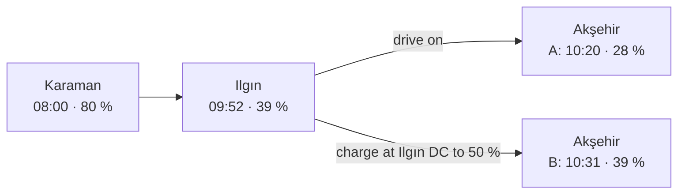
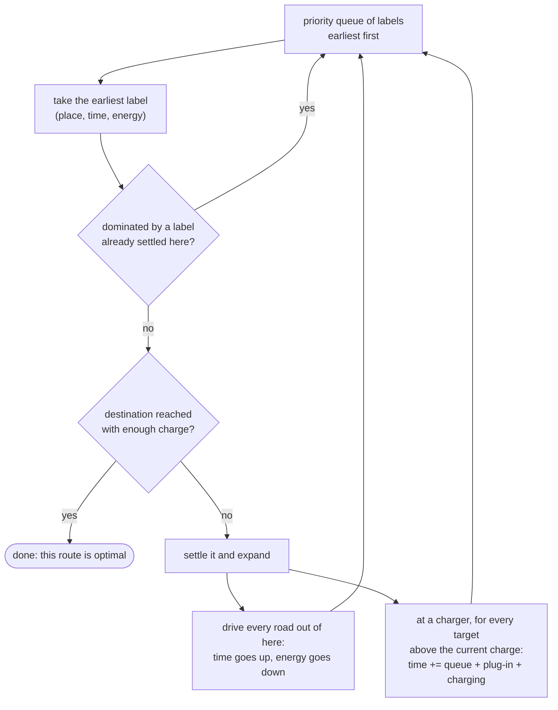

# A gentle guide to the EVRoute algorithms

**English** · [Türkçe](guide.tr.md) · [Documentation](index.md) · [Model](model.md) · [Algorithms & proofs](algorithms.md)

This guide explains, step by step and without formulas you have to
remember, how EVRoute finds the best way to drive an electric car with
charging stops: why the textbook shortest-path algorithm is not enough, what
the planners do instead, why their answers can be trusted, and which one to
use.  It is written for newcomers; every section ends with a pointer to the
exact statements and proofs for experts.  Every number below is produced by
the code (the commands are in this guide, the [README](../README.md) or
the [documentation](index.md)); the running example is the README's
**Karaman → İstanbul** trip: 747 km, an 85 kWh C-SUV leaving at 08:00 with
80 %, 10 % reserve on the way and on arrival, expected queues at every
charger.

Contents: [1. Why plain A\* is not enough](#1-why-plain-a-is-not-enough) ·
[2. Labels and dominance](#2-labels-and-dominance) ·
[3. BLS](#3-bls-dijkstra-with-labels) · [4. BLS-A\*](#4-bls-a-aim-the-torch-at-the-goal) ·
[5. CFP](#5-cfp-decide-later-how-much-to-charge) · [6. CFP-A\*](#6-cfp-a) ·
[7. Pareto](#7-pareto-time-money-and-wear-at-once) ·
[8. The simple methods](#8-the-simple-methods) ·
[9. Eco speeds, queues, cold weather](#9-eco-speeds-queues-and-cold-weather-the-same-machinery) ·
[10. How we know the answers are right](#10-how-we-know-the-answers-are-right) ·
[11. Tariffs](#11-tariffs-there-is-no-single-best-route) ·
[12. Which planner should I use?](#12-which-planner-should-i-use)

## 1. Why plain A\* is not enough

A navigation system finds the fastest route with Dijkstra's algorithm or its
goal-directed variant A\*.  Both keep **one number per place**: the earliest
time at which you can be there.  That is enough for a petrol car, because
arriving earlier is always better.

For an electric car it is not.  Take Akşehir, 239 km into the trip.  You can
get there in (at least) two sensible ways:



Route **A** is there earlier (10:20 against 10:31), route **B** with more
in the battery (39 % against 28 %).  Which one is better depends on what comes
*after* Akşehir: where the next chargers are, how fast they charge, how long
their queues are.  (On this trip the optimum continues from A and charges at
Akşehir itself; on another trip B could win.)  A planner that keeps only the
earliest arrival would throw B away for good.  So both must be kept, and the
problem stops being "one criterion" (time) and becomes **two criteria: time
and energy**.

<details>
<summary>Reproduce these numbers</summary>

```python
from evroute import evaluate, plan
from evroute.generators.presets import get_scenario
from evroute.plan import ChargeDecision, PlanDecision
from evroute.units import format_clock

sc = get_scenario("turkey-karaman-istanbul")
P = sc.prepare()
best = plan(sc, "bls-astar")
names = [P.net.node_name.get(v, "") for v in best.nodes]
ilgin, aksehir = names.index("Ilgın"), names.index("Akşehir")
dc, ac = sorted(P.station_at[best.nodes[ilgin]], key=lambda s: P.stations[s].kind != "DC")

def at_aksehir(*stop):
    """Clock and SoC on arrival at Akşehir, optionally after a stop at Ilgın."""
    charges = [ChargeDecision(ilgin, stop[0], stop[1] * P.capacity)] if stop else []
    r = evaluate(P, PlanDecision(best.edges[:aksehir], best.levels[:aksehir], charges))
    return f"{format_clock(P.departure_s + r.node_arrive_s[-1])}  {r.node_energy_arrive[-1] / P.capacity:.0%}"

print("A  no stop at Ilgın:        ", at_aksehir())
print("B  Ilgın DC up to 50 %:     ", at_aksehir(dc, 0.50))
print("C  Ilgın AC up to 44 %:     ", at_aksehir(ac, 0.44))
```

```text
A  no stop at Ilgın:         10:20  28%
B  Ilgın DC up to 50 %:      10:31  39%
C  Ilgın AC up to 44 %:      10:46  33%
```

`evaluate()` is the independent replay of section 10; it accepts any
decision, also a half trip like this one.
</details>

## 2. Labels and dominance

EVRoute calls such a partial route a **label**: *(place, time, energy)* -
"I can be in Akşehir at 10:20 with 28 %".  One label **dominates** another at
the same place if it is **no later and has no less energy**.  A dominated
label can be thrown away: whatever the dominated one can still do, the
dominating one can do too, no later and with at least as much charge.

Route **C** above charges at the slow AC charger in Ilgın instead and
reaches Akşehir at 10:46 with 33 %.  B is earlier *and* fuller, so B
dominates C and C is discarded.  A and B stay: neither dominates the other.
The labels that survive at a place form a **staircase** - the later, the
fuller:

| label at Akşehir | arrival | battery | kept? |
|---|---|---|---|
| A: drive on | 10:20 | 28 % | yes |
| B: Ilgın DC to 50 % | 10:31 | 39 % | yes |
| C: Ilgın AC to 44 % | 10:46 | 33 % | no - B is earlier and fuller |

When money matters too (the *cost objective*, section 7), the label also
records the money and battery wear spent so far, and dominance compares them
as well.

*For experts:* the pruning rule is Lemma 1 of
[`algorithms.md`](algorithms.md#1-the-battery-expanded-state-space); with
time-dependent queues or tariffs and the cost objective it compares
*(money and wear, time, energy)*, because comparing the total cost can be
unsound there.

## 3. BLS: Dijkstra with labels

**BLS** (*battery-constrained label setting*) is Dijkstra's algorithm with
labels instead of single times.  A priority queue holds labels, earliest
first:



- **On the road** time increases and energy decreases.  Downhill,
  regenerative braking can *add* energy, but never beyond a full battery.
- **At a charger** BLS creates one new label for every *charging target* on
  a grid: every 2 % of state of charge, plus the breakpoints of the charging
  curve (where the charging power changes).  Each new label pays the
  expected queue at that time, the plug-in time and the exact charging time
  from the current energy to the target.
- A label that would drop **below the reserve** is never created.

*Why is it correct?*  Two facts.  Every step is **monotone**: more energy
never hurts later, an earlier start never makes you arrive later.  And the
queues are **FIFO** (first in, first out): joining a queue earlier never gets
you out of it later.  Together they make discarding dominated labels safe,
and the first label that reaches the destination with enough charge is
optimal.

*How good is it?*  BLS is exact **for targets on its grid**.  On Karaman →
İstanbul it settles 42,980 labels and is 15.6 s behind the continuous
optimum of section 5 (8:06:56 against 8:06:41) - the price of the 2 % grid.
A finer grid shrinks the gap (experiment `grid-resolution`).

*For experts:* Theorem 1 in [`algorithms.md` §2](algorithms.md#2-bls--battery-constrained-label-setting),
including consecutive stops at two different chargers of one site.

## 4. BLS-A\*: aim the torch at the goal

Dijkstra pours water on the map: it spreads in every direction, also back
towards Karaman, until it reaches İstanbul.  **A\*** points a torch at the
goal instead.  It orders the queue not by the time so far, but by the time
so far **plus an optimistic estimate of the time still needed**:

> remaining time ≥ fastest remaining driving time
> \+ (energy still missing) ÷ (highest charging power anywhere)

The energy still missing is what the rest of the trip needs at the very
least, minus what is in the battery.  This estimate never overestimates,
and it is **consistent**: along a road or at a charger it never drops by
more than the step costs.  Consistency is what makes A\* work with labels:
a dominating label always leaves the queue before the label it dominates, so
the pruning of section 3 stays exact.  BLS-A\*'s default ("tight")
estimate is a little sharper still: it measures time and energy on the same
path and counts the charging stops that cannot be avoided.

The result is the **same optimum with 29 times fewer labels**: 1,491 instead
of 42,980, 38 ms instead of 258 ms.  The search replay of the viewer shows
the difference - BLS-A\* explores a narrow corridor of 73 places, BLS
floods 493:

<p align="center"></p>

*For experts:* Theorem 2 and Lemma 2 in
[`algorithms.md` §3](algorithms.md#3-a-consistent-heuristic-for-the-battery-state-space).

## 5. CFP: decide later how much to charge

BLS must decide *at the charger* how much to charge, from its grid.  But the
right amount depends on what comes later.  **CFP** (*charging function
propagation*, Baum et al.) postpones that decision.

A CFP label does not store one energy but a **function**: *B(t)* = "if I
want to be here at time *t*, how much energy can I have?"  The later you
want to arrive, the longer you could have charged at the last charger, so
*B* grows with *t* until the battery is full.  It is piecewise linear, and
it moves along roads in closed form.

At the next charger the label must choose *when to stop charging at the old
one and switch to the new one*.  The key fact (Lemma 3) is that the best
moment lies at a **breakpoint of B**, where the charging power of the old
charger changes.  So CFP only tries a handful of switch points, yet the
charged amounts are continuous.  Real charging curves are not perfectly
concave - the power *rises* at low SoC - and queues change during the day;
CFP then also tries the points where the new charger's power rises and the
knots of the queue profile, which keeps it exact.

The result is the **true continuous optimum**.  On Karaman → İstanbul:
Akşehir 28 → 54 %, Kütahya 10 → 72 %, arrival with **exactly** the required
10 %, 8:06:41.

*For experts:* Lemma 3, the extended candidate set and Theorem 3 in
[`algorithms.md` §4](algorithms.md#4-cfp--charging-function-propagation-continuous-charging).

## 6. CFP-A\*

CFP with the torch of section 4: the same optimum with **16 times fewer
labels** (347 instead of 5,665; 27 ms instead of 383 ms).  It scales: on
synthetic countries of 40 000 nodes CFP-A\* answers in 2.5 s on average
(BLS-A\*: 1.7 s), while Dijkstra-order CFP runs out of its label budget on 6
of 8 trips (experiment `scalability`).  On the real OpenStreetMap network of
Turkey (44 673 nodes) the median over six trips is 9.9 s for CFP-A\* and
4.0 s for BLS-A\* ([real-data case study](real-data.md)).

## 7. Pareto: time, money and wear at once

So far "best" meant fastest.  But a trip also costs **money** (charging) and
**battery wear** (fast charging at high SoC ages the pack).  These pull
against time: the fastest charger is rarely the cheapest.  There is **no
single best route** - only routes that cannot be improved in one criterion
without getting worse in another.  Together they form the **Pareto front**.

`pareto` finds that front exactly: Martins' multi-criteria label setting
(labels now carry time, money and wear), with the goal-directed pruning of
NAMOA\*: a label is dropped as soon as its optimistic completion is already
beaten by a route found earlier.  On Antalya → Ankara the front has **495
routes**; the cheapest saves 33.07 TRY (−5.6 %) for 34 minutes more than the
fastest.

Exact fronts can be large: on the 750 km Karaman → İstanbul the
three-criteria front does not fit the default budget of 2 million labels.
`criteria=("time", "money")` and a label budget keep it interactive (the
README shows both).  If you can say what an hour of your time is worth,
you do not need the whole front: the **cost objective**
(`objective="cost"`) minimises *value of time × trip time + money + wear*
with BLS or BLS-A\* and returns one plan from the front.

*For experts:* [`algorithms.md` §5](algorithms.md#5-multi-criteria-search).

## 8. The simple methods

EVRoute ships four simple planners so that the exact ones have something to
be compared with.  On Karaman → İstanbul:

| planner | what it does | result |
|---|---|---|
| `naive` | fastest route, battery ignored | strands after **364 km** |
| `greedy` | an in-car navigator: when the battery is short, detour to a good station and charge to 80 % (DC) | feasible, but **24 minutes slower and 46 % dearer**: it charges on the slow part of the curve and arrives with 47 % it did not need |
| `station-graph` | Dijkstra over the stations, always charging to a fixed level (100 %) | **15 % slower** |
| `genetic` | a seeded genetic algorithm over station sequences and targets | close (+0.37 %), but **without a guarantee** |

Over 60 random trips of at least 300 km (experiment `optimality-gap`) the
average gap to the continuous optimum is 5.2 % for greedy, 12.8 % for the
station graph, 0.75 % for the genetic algorithm - and 0.11 % for BLS-A\* on
its 2 % grid (at most 0.26 %).

*For experts:* [`algorithms.md` §7](algorithms.md#7-baselines).

## 9. Eco speeds, queues and cold weather: the same machinery

The label mechanism does not need to change for the other effects of the
model; they only change the numbers the labels are built from.

- **Eco speeds**: a road offers several (time, energy) options - 100, 90 or
  80 % of the speed.  BLS simply tries each, and dominance discards the
  useless ones.  Allowing slower speeds shortens 24 of 80 trips, by up to
  2.8 minutes: driving one leg slower can save more charging time than it
  costs (experiment `eco-speed`).
- **Queues**: each charger is an Erlang-C queue with a demand profile over
  the day, made FIFO-safe; the expected wait at the arrival time is just
  part of the stop's duration.  Planning with the expected queues saves 3.4
  minutes on average and up to 21.7 minutes (leaving Karaman at 12:00)
  against a queue-blind plan (experiment `queue-awareness`).
- **Cold weather**: a smaller usable battery, heating power on the road and
  slower DC charging for a cold battery change capacities, consumptions and
  charging functions - the search stays the same.  Karaman → İstanbul takes
  8 h 07 min at 20 °C, 8 h 37 min at −15 °C with a preconditioned battery
  and 10 h 24 min without (experiment `temperature`).

*For experts:* every equation in [`model.md`](model.md).

## 10. How we know the answers are right

"Optimal" is a strong word, so EVRoute checks it in several independent ways:

1. **An independent evaluator.**  `evaluate()` replays every plan of every
   planner from first principles - energies, reserves, queues, charging
   curves, money, wear - with code the planners do not share.  An exact
   planner must report exactly the objective the evaluator measures.
2. **Brute force.**  On tiny road networks an exhaustive enumeration of all
   walks, stops and targets must agree with BLS and the Pareto front.
3. **Cross-validation.**  Thousands of seeded random instances (3 200 in the
   slow tier) check that BLS = BLS-A\*, CFP = CFP-A\*, CFP is never slower
   than BLS, nothing beats CFP, and much more.

This is how real bugs were found.  One example: all exact planners allowed
at most one charging stop per visit of a place - "two stops would pay the
queue twice".  But with two *different* chargers at one place that is
false: on a cold line, a fast DC charger up to 37.4 kWh and then the AC
charger next to it is 16 s faster than CFP's "optimum".  The evaluator
accepted the faster plan, the cross-validation found it, and BLS, Pareto
and CFP were fixed (consecutive stops at different chargers of one site).

*For experts:* [`algorithms.md` §8](algorithms.md#8-how-correctness-is-verified)
and the report [`tests/fuzz_report.md`](../tests/fuzz_report.md).

## 11. Tariffs: there is no single best route

Charging prices are not flat in practice, and EVRoute models two common
practices (`Tariff`):

- **The 80 % rule.**  Above about 80 % SoC charging is slow, so a car that
  keeps charging there blocks a fast charger for little energy.  Operators
  discourage it with a higher price per kWh above 80 %, and the drivers in
  the queue do not like it either.
- **Peak hours.**  At busy times of day a peak factor applies - on fixed
  clock hours, or whenever a charger's queue model expects it to be busy.

(In Turkey public stations have had one AC and one DC price per operator
since March 2026, without tiers by state of charge, so the 80 % rule is an
illustration there; prices by time of day remain allowed:
[real-data case study](real-data.md#prices-and-the-march-2026-regulation).)

The rule that makes this interesting: **the price of a session is fixed when
the car joins the queue.**  A car that reaches a charger three minutes before
the peak ends can *wait* and pay the off-peak price for the whole session.
That is a new decision, a **voluntary hold**, and a planner must decide
where it pays.

The README example is Karaman → İstanbul leaving at **14:00** under the
illustrative demonstration tariff (×1.3 above 80 %, a 16:00-20:00 peak at
×1.15, ×2.3 above 80 % in the peak):

- the **fastest** plan makes the same two stops as at 08:00, but both fall
  into the peak: 8 h 09 min for 1,309.59 TRY instead of 1,138.78 (+15 %);
- the **balanced** plan (cost objective, an hour is worth 250 TRY) charges
  at Ilgın before the peak, and at İnegöl waits 2.4 minutes for 20:00:
  8 h 20 min for 1,111.61 TRY;
- the **cheapest** plan uses three slow AC chargers and never charges above
  80 %: 14 h 44 min for 796.58 TRY;
- the time-money Pareto front between them has **268 plans**; 28 of them
  wait for a cheaper price somewhere.

The balanced plan's stop at İnegöl, minute by minute:

```mermaid
gantt
    title İnegöl DC in the balanced plan (arrival 19.57)
    dateFormat HH:mm:ss
    axisFormat %H:%M
    section Price
    peak (×1.15)            :p1, 19:57:37, 20:00:00
    off-peak (×1)           :p2, 20:00:00, 20:22:15
    section Car
    hold for the cheaper price :crit, h1, 19:57:37, 20:00:00
    queue                   :q1, 20:00:00, 20:01:44
    plug in                 :s1, 20:01:44, 20:04:44
    charge 10 to 52 %       :c1, 20:04:44, 20:22:15
```



<p align="center"></p>

The front is steep at first and then flat: 11 minutes more save 197.98 TRY,
the next 6 h 24 min only 315.04 TRY more.  Which plan is "best" depends on
what an hour is worth to *you* - that is why there is no single best route,
and why the Pareto search shows them all.

**Why the time objective never waits.**  Waiting cannot make you faster:
queues are first in, first out, so joining later never gets you out
earlier, and the price does not enter the trip time.  BLS-A\* with the time
objective and CFP therefore never hold, and their trip time does not depend
on the prices at all - only the bill does.

**Why waiting until a price change is enough.**  For the cost objective and
the Pareto search there are infinitely many possible waits (until 19:58,
19:59, 20:00:30, ...).  EVRoute only tries "join now" and "join at each
price change of this charger within the next 24 hours", and this is
provably enough: waiting past the start of a price period only costs time
(the price stays the same, the queue does not get you out earlier), so the
best moment to join in any period is its first moment.  The same argument
shows that throwing away dominated labels stays exact: a label that is no
later, no dearer and no emptier can copy the other's plan, waiting at each
stop until the start of the period the other one joined in.

*For experts:* the model in [`model.md` §5](model.md#5-charging-tariffs);
Lemma 4 (holds never save time), Lemma 5 and Theorem 4 (exactness with
holds), and the two rule changes (3-D dominance, a second session at the
same charger in the other price period) in
[`algorithms.md` §6](algorithms.md#6-charging-tariffs-price-periods-and-voluntary-holds).

## 12. Which planner should I use?

**Short answer:** `bls-astar` - simple, versatile (time and cost objectives,
tariffs, eco speeds, time-dependent queues) and on average 0.11 % from the
continuous optimum.  If only the trip time matters and you want the exact
continuous optimum, `cfp-astar`.

| you want | use | why |
|---|---|---|
| a good plan, fast, for time **or** cost (the default) | `bls-astar` | exact on its 2 % charging grid (0.11 % from the continuous optimum on average, at most 0.26 %), tens of milliseconds on the Turkey network; exact for the cost objective too, tariffs included |
| the exact fastest trip with continuous charging amounts | `cfp-astar` | the true continuous optimum for the trip time; time objective only (with `objective="cost"` it still returns the fastest route) |
| to see the trade-off and choose yourself | `pareto` with `criteria=("time", "money")` | the exact front; set `max_labels`, and a coarser `charge_step_soc` (e.g. 0.05) on long trips with a tariff |
| one plan that weighs time against money | `bls-astar` with `objective="cost"` and your `value_of_time_per_h` | picks one point of the front; with a tariff it also decides where to wait |
| a reference or a teaching example | `bls`, `cfp` | the same optima in Dijkstra order: slower, but the search is easy to follow in the viewer's search replay |
| a baseline to beat | `greedy`, `station-graph`, `genetic`, `naive` | how a navigator, a fixed-target planner and a metaheuristic do; no optimality guarantee |

From the command line: `evroute plan SCENARIO -a bls-astar` (the default),
`-a cfp-astar`, `--objective cost`; `evroute compare SCENARIO` runs several
planners side by side, and `evroute viz SCENARIO -o trip.html` shows them in
the viewer.
