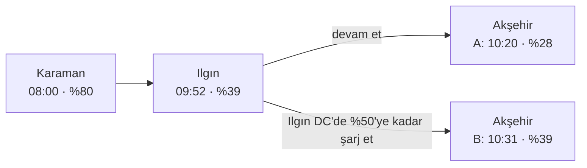
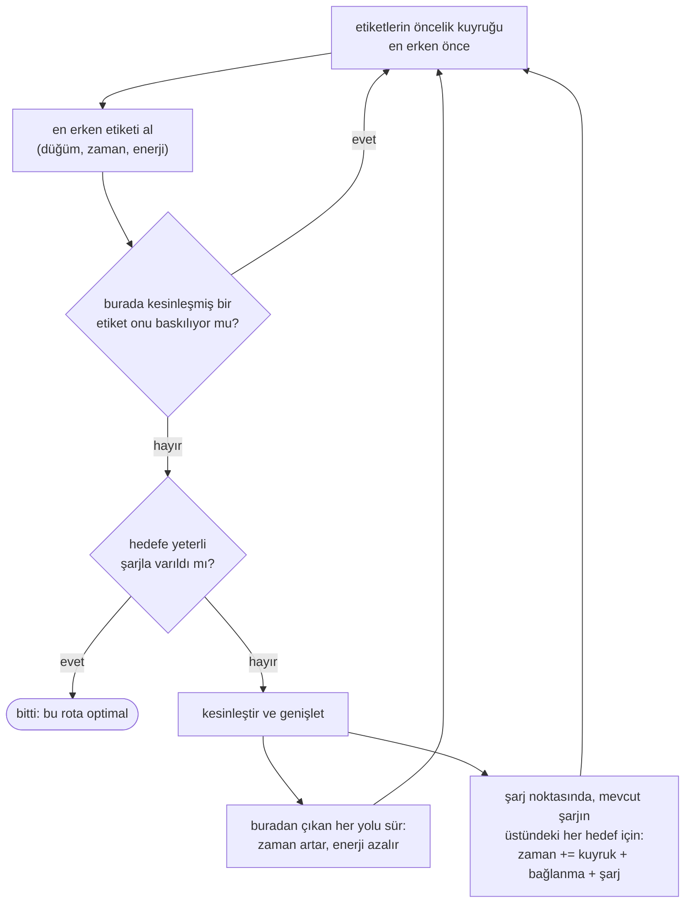

# EVRoute algoritmaları: adım adım bir rehber

[English](guide.md) · **Türkçe** · [Dokümantasyon](index.md) · [Model](model.md) · [Algoritmalar ve ispatlar](algorithms.md)

Bu rehber, EVRoute'un elektrikli bir aracı şarj molalarıyla birlikte en iyi
şekilde nasıl yola çıkardığını, ezberlenecek formüller olmadan, adım adım
anlatır: ders kitabındaki en kısa yol algoritması neden yetmez, planlayıcılar
onun yerine ne yapar, yanıtlarına neden güvenilebilir ve hangisi ne zaman
kullanılmalı. Konuya yeni başlayanlar için yazıldı; her bölüm, kesin
ifadeleri ve ispatları arayan uzmanlar için bir bağlantıyla biter. Aşağıdaki
her sayı kodun ürettiği bir sonuçtur (komutlar bu rehberde,
[README](../README.tr.md) dosyasında ya da [dokümantasyonda](index.md)). Son
bölümler uygulamaya dönüktür: hangi planlayıcının kullanılacağı, bir planın
yalnızca birkaç puanlık şarj için mola vermesinin nasıl önleneceği ve web
uygulamasının günlük kullanım modu. Baştan sona kullanılan örnek,
README'deki **Karaman → İstanbul** yolculuğu: 747 km, 85 kWh bataryalı bir
C-SUV, saat 08:00'de %80 şarjla yola çıkıyor; yol boyunca ve varışta %10
rezerv korunuyor, her şarj noktasında beklenen kuyruklar hesaba katılıyor.

İçindekiler: [1. Düz A\* neden yetmiyor?](#1-düz-a-neden-yetmiyor) ·
[2. Etiket ve baskınlık](#2-etiket-ve-baskınlık) ·
[3. BLS](#3-bls-etiketli-dijkstra) · [4. BLS-A\*](#4-bls-a-feneri-hedefe-tutmak) ·
[5. CFP](#5-cfp-ne-kadar-şarj-edileceğine-sonra-karar-vermek) ·
[6. CFP-A\*](#6-cfp-a) · [7. Pareto](#7-pareto-süre-para-ve-yıpranma-bir-arada) ·
[8. Basit yöntemler](#8-basit-yöntemler) ·
[9. Eko hız, kuyruklar, soğuk hava](#9-eko-hız-kuyruklar-ve-soğuk-hava-aynı-mekanizma) ·
[10. Doğrulama](#10-yanıtların-doğru-olduğunu-nereden-biliyoruz) ·
[11. Tarifeler](#11-tarifeler-tek-bir-en-iyi-rota-yok) ·
[12. Hangi planlayıcı?](#12-hangi-planlayıcıyı-kullanmalıyım) ·
[13. Taban kuralı](#13-her-molada-asgari-şarj-düzeyi-taban-kuralı) ·
[14. Günlük kullanım modu](#14-günlük-kullanım-modu)

## 1. Düz A\* neden yetmiyor?

Bir navigasyon cihazı en hızlı rotayı Dijkstra algoritmasıyla ya da onun
hedefe yönelik biçimi A\* ile bulur. İkisi de **her düğüm için tek bir değer**
tutar: oraya en erken varış zamanı. Benzinli bir araç için bu yeterlidir,
çünkü bir yere daha erken varmak her zaman daha iyidir.

Elektrikli araçta öyle değil. Yolculuğun 239. kilometresindeki Akşehir'i
düşünün. Oraya (en az) iki makul biçimde varılabilir:



**A** yolu Akşehir'e 10:20'de, yani daha erken varır; **B** yolu 10:31'de,
ama bataryada %28 yerine %39'la. Hangisinin iyi olduğu
Akşehir'den *sonrasına* bağlıdır: sıradaki şarj istasyonları nerede, ne hızlı
şarj ediyorlar, kuyrukları ne kadar uzun? (Bu yolculukta optimum A'dan devam
eder ve Akşehir'in kendisinde şarj eder; başka bir yolculukta B kazanabilir.)
Yalnızca en erken varışı tutan bir planlayıcı B'yi temelli atar. O yüzden
ikisi de tutulmalı: problem tek ölçütlü (süre) olmaktan çıkar, **iki ölçütlü,
(zaman, enerji)** olur.

<details>
<summary>Bu sayıları kendiniz üretin</summary>

```python
from evroute import evaluate, plan
from evroute.generators.presets import get_scenario
from evroute.plan import ChargeDecision, PlanDecision
from evroute.units import format_clock

sc = get_scenario("turkey-karaman-istanbul")
P = sc.prepare()
best = plan(sc, "bls-astar")
names = [P.net.node_name.get(v, "") for v in best.nodes]
ilgin, aksehir = names.index("Ilgın"), names.index("Akşehir")
dc, ac = sorted(P.station_at[best.nodes[ilgin]], key=lambda s: P.stations[s].kind != "DC")

def at_aksehir(*stop):
    """Akşehir'e varıştaki saat ve SoC; istenirse Ilgın'da bir moladan sonra."""
    charges = [ChargeDecision(ilgin, stop[0], stop[1] * P.capacity)] if stop else []
    r = evaluate(P, PlanDecision(best.edges[:aksehir], best.levels[:aksehir], charges))
    return f"{format_clock(P.departure_s + r.node_arrive_s[-1])}  {r.node_energy_arrive[-1] / P.capacity:.0%}"

print("A  Ilgın'da mola yok:        ", at_aksehir())
print("B  Ilgın DC'de %50'ye kadar:  ", at_aksehir(dc, 0.50))
print("C  Ilgın AC'de %44'e kadar:   ", at_aksehir(ac, 0.44))
```

```text
A  Ilgın'da mola yok:         10:20  28%
B  Ilgın DC'de %50'ye kadar:   10:31  39%
C  Ilgın AC'de %44'e kadar:    10:46  33%
```

`evaluate()`, 10. bölümdeki bağımsız yeniden simülasyondur; buradaki gibi
yarım bir yolculuk da dahil, her kararı kabul eder.
</details>

## 2. Etiket ve baskınlık

EVRoute böyle bir kısmi rotaya **etiket** der: *(düğüm, zaman, enerji)*, yani
"Akşehir'de 10:20'de %28'le olabilirim". Aynı düğümdeki bir etiket, diğerinden
**daha geç değilse ve daha az enerjiye sahip değilse** onu **baskılar**
(domine eder). Baskılanan etiket atılabilir: onun hâlâ yapabileceği her şeyi
baskın etiket de yapabilir, hem daha geç kalmadan hem de en az o kadar
şarjla.

Yukarıdaki **C** yolu Ilgın'da yavaş AC ünitesinde şarj eder ve Akşehir'e
10:46'da %33'le varır. B hem daha erken *hem* daha dolu olduğundan C'yi
baskılar; C atılır. A ile B ise kalır, çünkü hiçbiri diğerini baskılamaz.
Bir düğümde hayatta kalan etiketler **merdiven** gibi dizilir: daha geç olan
daha doludur.

| Akşehir'deki etiket | varış | batarya | tutulur mu? |
|---|---|---|---|
| A: devam et | 10:20 | %28 | evet |
| B: Ilgın DC'de %50'ye kadar | 10:31 | %39 | evet |
| C: Ilgın AC'de %44'e kadar | 10:46 | %33 | hayır: B hem daha erken hem daha dolu |

Para da önemli olduğunda (*maliyet amacı*, 7. bölüm) etiket o ana kadar
harcanan parayı ve batarya yıpranmasını da tutar; baskınlık bunları da
karşılaştırır.

*Uzmanlar için:* budama kuralı
[`algorithms.md`](algorithms.md#1-the-battery-expanded-state-space)
dosyasındaki Lemma 1'dir; zamana bağlı kuyruklarda ya da tarifelerde maliyet
amacı *(para ve yıpranma, zaman, enerji)* üçlüsünü karşılaştırır, çünkü orada
toplam maliyeti karşılaştırmak geçersiz (unsound) olabilir.

## 3. BLS: etiketli Dijkstra

**BLS** (*battery-constrained label setting*, batarya kısıtlı etiket
belirleme), tek tek zamanlar yerine etiketlerle çalışan Dijkstra
algoritmasıdır. Bir öncelik kuyruğu etiketleri tutar, en erkeni önce:



- **Yolda** zaman artar, enerji azalır. Yokuş aşağı rejeneratif frenleme
  enerjiyi *artırabilir*, ama hiçbir zaman batarya kapasitesinin üstüne
  çıkaramaz.
- **Şarj noktasında** BLS bir ızgaradaki her *şarj hedefi* için yeni bir
  etiket üretir: her %2'lik SoC adımı ve şarj eğrisinin kırılma noktaları
  (şarj gücünün değiştiği yerler). Her yeni etiket o andaki beklenen kuyruğu,
  bağlanma süresini ve mevcut enerjiden hedefe kadar kesin şarj süresini
  öder.
- **Rezervin altına düşen** etiket hiç doğmaz.

*Neden doğru?* İki olgu yüzünden. Her adım **monotondur**: daha fazla enerji
ileride hiçbir zaman zarar vermez, daha erken yola çıkmak hiçbir zaman daha
geç varmaya yol açmaz. Kuyruklar da **FIFO**'dur (ilk giren ilk çıkar):
kuyruğa daha erken girmek oradan hiçbir zaman daha geç çıkarmaz. İkisi
birlikte baskılanan etiketleri atmayı güvenli kılar ve hedefe yeterli şarjla
ulaşan ilk etiket optimaldir.

*Ne kadar iyi?* BLS **kendi ızgarasındaki hedefler için** kesindir. Karaman →
İstanbul'da 42 980 etiket kesinleştirir ve 5. bölümdeki sürekli optimumun
15,6 sn gerisinde kalır (8:06:41 yerine 8:06:56): %2'lik ızgaranın bedeli.
Izgara inceldikçe açık küçülür (`grid-resolution` deneyi).

*Uzmanlar için:* [`algorithms.md` §2](algorithms.md#2-bls--battery-constrained-label-setting)
dosyasındaki Teorem 1; aynı istasyondaki iki farklı şarj ünitesinde art arda
molalar dahil.

## 4. BLS-A\*: feneri hedefe tutmak

Dijkstra haritaya su döker gibidir: su her yöne, Karaman'ın gerisine bile
yayılır, ta ki İstanbul'a ulaşana kadar. **A\*** ise feneri hedefe tutar.
Kuyruğu o ana kadarki süreye göre değil, o ana kadarki süre **artı kalan
sürenin iyimser bir tahminine** göre sıralar:

> kalan süre ≥ kalan en hızlı sürüş süresi
> \+ (eksik enerji) ÷ (herhangi bir istasyondaki en yüksek şarj gücü)

Eksik enerji, yolculuğun geri kalanının en az ihtiyaç duyduğu enerjiden
bataryadakini çıkarınca kalandır. Bu tahmin hiçbir zaman gerçeği aşmaz ve
**tutarlıdır** (consistent): bir yol boyunca ya da bir şarj noktasında
adımın bedelinden fazla düşmez. A\*'ı etiketlerle çalışır kılan bu
tutarlılıktır: baskın etiket, baskıladığı etiketten her zaman önce
kuyruktan çıkar; böylece 3. bölümdeki budama doğru kalır. BLS-A\*'ın
varsayılan ("sıkı", tight) tahmini biraz daha keskindir: süreyi ve enerjiyi
aynı yol üzerinde ölçer ve kaçınılmaz şarj molalarını da sayar.

Sonuç: **aynı optimum, 29 kat daha az etiket**: 42 980 yerine 1 491, 258 ms
yerine 38 ms. Görüntüleyicinin arama tekrarı farkı gösteriyor: BLS-A\* 73
düğümlük dar bir koridoru tararken BLS 493 düğüme yayılıyor:

<p align="center"></p>

*Uzmanlar için:* [`algorithms.md` §3](algorithms.md#3-a-consistent-heuristic-for-the-battery-state-space)
dosyasındaki Teorem 2 ve Lemma 2.

## 5. CFP: ne kadar şarj edileceğine sonra karar vermek

BLS ne kadar şarj edeceğine *şarj noktasında*, ızgarasından seçerek karar
vermek zorundadır. Oysa doğru miktar sonrasına bağlıdır. **CFP** (*charging
function propagation*, şarj fonksiyonu yayılımı; Baum vd.) bu kararı
erteler.

CFP etiketi tek bir enerji değil, bir **fonksiyon** tutar: *B(t)* = "buraya
*t* anında varmak istersem elimde ne kadar enerji olabilir?" Ne kadar geç
varmayı kabul ederseniz son istasyonda o kadar uzun şarj edebilirsiniz; bu
yüzden *B*, batarya dolana kadar *t* ile artar. Parçalı doğrusaldır ve
yollar boyunca kapalı formda taşınır.

Sonraki şarj noktasında etiket, *eskisinde şarjı ne zaman bırakıp yenisine
geçeceğini* seçmelidir. Temel olgu (Lemma 3): en iyi geçiş anı, *B*'nin bir
**kırılma noktasındadır**, yani eski şarj ünitesinin gücünün değiştiği
yerde. CFP bu yüzden yalnızca bir avuç geçiş noktası dener, ama şarj
miktarları sürekli kalır. Gerçek şarj eğrileri tam içbükey (konkav) değildir
(düşük SoC'de güç *artar*) ve kuyruklar gün içinde değişir; CFP o zaman yeni
ünitenin gücünün arttığı noktaları ve kuyruk profilinin düğüm noktalarını da
dener, böylece kesin kalır.

Sonuç, **gerçek sürekli optimumdur**. Karaman → İstanbul'da: Akşehir %28 →
%54, Kütahya %10 → %72, varışta gereken %10 **tam olarak**, 8:06:41.

*Uzmanlar için:* [`algorithms.md` §4](algorithms.md#4-cfp--charging-function-propagation-continuous-charging)
dosyasındaki Lemma 3, genişletilmiş aday kümesi ve Teorem 3.

## 6. CFP-A\*

4. bölümün feneriyle CFP: aynı optimum, **16 kat daha az etiket** (5 665
yerine 347; 383 ms yerine 27 ms). Ölçeklenir de: 40 000 düğümlü sentetik
ülkelerde CFP-A\* ortalama 2,5 sn'de yanıt verir (BLS-A\*: 1,7 sn); Dijkstra
sırasındaki CFP ise 8 yolculuğun 6'sında etiket bütçesini aşar
(`scalability` deneyi). Türkiye'nin gerçek OpenStreetMap ağında (44 673
düğüm) altı yolculuğun medyanı CFP-A\* için 9,9 sn, BLS-A\* için 4,0 sn'dir
([gerçek veriyle vaka çalışması](real-data.tr.md)).

## 7. Pareto: süre, para ve yıpranma bir arada

Buraya kadar "en iyi", en hızlı demekti. Ama bir yolculuğun **parası** (şarj)
ve **batarya yıpranması** (yüksek SoC'de hızlı şarj paketi yaşlandırır) da
vardır. Bunlar süreyle çekişir: en hızlı şarj ünitesi nadiren en ucuzudur.
**Tek bir en iyi rota yoktur**; yalnızca bir ölçütte, başka bir ölçütte
kötüleşmeden iyileştirilemeyen rotalar vardır. Hepsi birlikte **Pareto
cephesini** oluşturur.

`pareto` bu cepheyi kesin olarak bulur: Martins'in çok ölçütlü etiket
belirlemesi (etiketler artık süre, para ve yıpranma taşır) ve NAMOA\*'nın
hedefe yönelik budaması; iyimser tamamlanışı daha önce bulunmuş bir rota
tarafından zaten geçilen etiket hemen atılır. Antalya → Ankara'da cephede
**495 rota** var; en ucuzu, en hızlıya göre 34 dakika daha uzun sürer ama
33,07 TRY (−%5,6) tasarruf sağlar.

Kesin cepheler büyük olabilir: 750 km'lik Karaman → İstanbul'da üç ölçütlü
cephe varsayılan 2 milyon etiketlik bütçeye sığmaz. `criteria=("time",
"money")` ve bir etiket bütçesi aramayı etkileşimli hızda tutar (README
ikisini de gösteriyor). Bir saatinizin ne ettiğini söyleyebiliyorsanız
cephenin tamamına ihtiyacınız yok: **maliyet amacı** (`objective="cost"`),
BLS ya da BLS-A\* ile *zamanın değeri × yolculuk süresi + para + yıpranma*
toplamını en küçükler ve cepheden tek bir plan döndürür.

*Uzmanlar için:* [`algorithms.md` §5](algorithms.md#5-multi-criteria-search).

## 8. Basit yöntemler

EVRoute, kesin planlayıcıların kıyaslanabileceği dört basit planlayıcıyla
gelir. Karaman → İstanbul'da:

| planlayıcı | ne yapar | sonuç |
|---|---|---|
| `naive` | en hızlı rota, batarya yok sayılır | **364. km'de** yolda kalır |
| `greedy` | araç içi navigasyon: batarya yetmeyecekse iyi bir istasyona sapar ve %80'e kadar şarj eder (DC) | uygulanabilir, ama **24 dakika daha yavaş ve %46 daha pahalı**: eğrinin yavaş kısmında şarj eder ve hedefe ihtiyaç duymadığı %47'yle varır |
| `station-graph` | istasyonlar üzerinde Dijkstra; her molada sabit bir seviyeye (%100) kadar şarj | **%15 daha yavaş** |
| `genetic` | istasyon dizileri ve hedefler üzerinde sabit tohumlu bir genetik algoritma | yakın (+%0,37), ama **garantisiz** |

En az 300 km'lik 60 rastgele yolculukta (`optimality-gap` deneyi) sürekli
optimuma göre ortalama açık greedy için %5,2, istasyon grafı için %12,8,
genetik algoritma için %0,75 ve %2'lik ızgarasıyla BLS-A\* için %0,11'dir
(en çok %0,26).

*Uzmanlar için:* [`algorithms.md` §7](algorithms.md#7-baselines).

## 9. Eko hız, kuyruklar ve soğuk hava: aynı mekanizma

Modelin diğer etkileri için etiket mekanizmasının değişmesi gerekmez; bunlar
yalnızca etiketlerin üzerine kurulduğu sayıları değiştirir.

- **Eko hız**: bir yol birden çok (süre, enerji) seçeneği sunar: hızın %100,
  %90 ya da %80'i. BLS her birini dener, işe yaramayanları baskınlık ayıklar.
  Daha düşük hızlara izin vermek 80 yolculuğun 24'ünü en çok 2,8 dakika
  kısaltır: bir etabı daha yavaş sürmek, kaybettirdiğinden daha fazla şarj
  süresi kazandırabilir (`eco-speed` deneyi).
- **Kuyruklar**: her şarj noktası, gün boyu bir talep profiline sahip, FIFO
  güvenli hâle getirilmiş bir Erlang-C kuyruğudur; varış anındaki beklenen
  bekleme, molanın süresinin bir parçasıdır, o kadar. Beklenen kuyruklarla
  planlamak, kuyrukları yok sayan bir plana göre ortalama 3,4 dakika, en çok
  21,7 dakika (Karaman'dan 12:00'de çıkışta) kazandırır (`queue-awareness`
  deneyi).
- **Soğuk hava**: daha küçük kullanılabilir batarya, yolda ısıtma gücü ve
  soğuk bataryada daha yavaş DC şarj; bunlar kapasiteleri, tüketimleri ve
  şarj fonksiyonlarını değiştirir, arama aynı kalır. Karaman → İstanbul 20
  °C'de 8 sa 07 dk sürer; −15 °C'de ön ısıtmalı bataryayla 8 sa 37 dk, ön
  ısıtma olmadan 10 sa 24 dk (`temperature` deneyi).

*Uzmanlar için:* tüm denklemler [`model.md`](model.md) dosyasında.

## 10. Yanıtların doğru olduğunu nereden biliyoruz?

"Optimal" iddialı bir sözcük; EVRoute bu yüzden onu birbirinden bağımsız
birkaç yolla denetler:

1. **Bağımsız değerlendirici.** `evaluate()`, her planlayıcının her planını
   temel ilkelerden (enerjiler, rezervler, kuyruklar, şarj eğrileri, para,
   yıpranma) planlayıcılarla ortak olmayan bir kodla yeniden simüle eder.
   Kesin bir planlayıcı, değerlendiricinin ölçtüğü amaç değerini birebir
   raporlamak zorundadır.
2. **Kaba kuvvet.** Küçük yol ağlarında bütün yürüyüşlerin, durakların ve
   hedeflerin eksiksiz sayımı, BLS ve Pareto cephesiyle örtüşmelidir.
3. **Çapraz doğrulama.** Binlerce sabit tohumlu rastgele örnek (yavaş
   katmanda 3 200) BLS = BLS-A\*, CFP = CFP-A\*, CFP'nin BLS'den hiçbir zaman
   yavaş olmadığını, hiçbir şeyin CFP'yi geçemediğini ve çok daha fazlasını
   sınar.

Gerçek hatalar bu yolla bulundu. Bir örnek: kesin planlayıcıların hepsi bir
düğüm ziyaretinde en çok bir şarj molasına izin veriyordu: "iki mola kuyruğu
iki kez öder". Ama aynı yerde iki *farklı* şarj ünitesi varsa bu yanlış:
soğuk bir hatta hızlı DC ünitesinde 37,4 kWh'e kadar şarj edip ardından
yanındaki AC ünitesine geçmek, CFP'nin "optimumundan" 16 sn daha hızlı.
Değerlendirici bu daha hızlı planı kabul etti, çapraz doğrulama onu buldu;
BLS, Pareto ve CFP düzeltildi (aynı istasyondaki farklı ünitelerde art arda
molalar).

*Uzmanlar için:* [`algorithms.md` §8](algorithms.md#8-how-correctness-is-verified)
ve [`tests/fuzz_report.md`](../tests/fuzz_report.md) raporu.

## 11. Tarifeler: tek bir en iyi rota yok

Gerçekte şarj fiyatları sabit değildir; EVRoute yaygın iki uygulamayı
modeller (`Tariff`):

- **%80 kuralı.** SoC yaklaşık %80'i geçince şarj yavaşlar; orada şarja
  devam eden bir araç, hızlı bir şarj ünitesini az bir enerji için meşgul
  eder. İşletmeciler %80'in üzerindeki her kWh'e daha yüksek fiyat koyarak
  bunu caydırır, kuyrukta bekleyen sürücüler de pek hoş karşılamaz.
- **Puant saatler.** Günün yoğun saatlerinde bir puant çarpanı uygulanır;
  ya sabit saat aralıklarında ya da şarj noktasının kuyruk modelinin
  yoğunluk beklediği saatlerde.

(Türkiye'de halka açık istasyonlarda Mart 2026'dan beri her operatörün bir
AC ve bir DC fiyatı vardır, batarya doluluk oranına (SoC) göre kademe yoktur; bu yüzden
%80 kuralı orada bir örnektir. Günün saatine göre fiyat ise serbesttir:
[gerçek veriyle vaka çalışması](real-data.tr.md#fiyatlar-ve-mart-2026-yönetmeliği).)

İşi ilginç kılan kural şu: **bir şarj oturumunun fiyatı, araç kuyruğa
girdiği anda belirlenir.** Puantın bitmesine üç dakika kala bir şarj
noktasına varan araç *bekleyebilir* ve bütün oturum için puant dışı fiyatı
öder. Bu yeni bir karardır, **gönüllü bekleme**; planlayıcı bunun nerede
kârlı olduğuna karar vermelidir.

README'deki örnek, örnekleme amaçlı gösterim tarifesiyle (%80'in üzerinde
×1,3; 16:00-20:00 puantında ×1,15; puantta %80'in üzerinde ×2,3) saat
**14:00'te** yola çıkan Karaman → İstanbul yolculuğudur:

- **en hızlı** plan 08:00'dekiyle aynı iki molayı verir, ama ikisi de
  puanta denk gelir: 1 138,78 yerine 1 309,59 TRY (+%15), 8 sa 09 dk;
- **dengeli** plan (maliyet amacı, bir saatin değeri 250 TRY) Ilgın'da
  puanttan önce şarj eder, İnegöl'de ise 20:00'yi 2,4 dakika bekler: 8 sa
  20 dk, 1 111,61 TRY;
- **en ucuz** plan üç yavaş AC ünitesi kullanır ve hiç %80'in üzerine
  çıkmaz: 14 sa 44 dk, 796,58 TRY;
- ikisinin arasındaki süre–para Pareto cephesinde **268 plan** var; 28'i bir
  yerde daha ucuz fiyatı bekliyor.

Dengeli planın İnegöl molası, dakika dakika:

```mermaid
gantt
    title Dengeli planda İnegöl DC (varış 19.57)
    dateFormat HH:mm:ss
    axisFormat %H:%M
    section Fiyat
    puant (×1,15)              :p1, 19:57:37, 20:00:00
    puant dışı (×1)            :p2, 20:00:00, 20:22:15
    section Araç
    ucuz fiyat için bekleme    :crit, h1, 19:57:37, 20:00:00
    kuyruk                     :q1, 20:00:00, 20:01:44
    bağlanma                   :s1, 20:01:44, 20:04:44
    şarj %10 → %52             :c1, 20:04:44, 20:22:15
```



<p align="center"></p>

Cephe önce dik, sonra yataydır: 11 dakika fazlası 197,98 TRY kazandırır,
sonraki 6 sa 24 dk ise yalnızca 315,04 TRY daha. Hangi planın "en iyi"
olduğu, bir saatin *sizin* için ne ettiğine bağlıdır. Tek bir en iyi rotanın
olmamasının ve Pareto aramasının hepsini göstermesinin nedeni budur.

**Süre amacı neden hiç beklemez?** Beklemek sizi hızlandıramaz: kuyruklarda
ilk giren ilk çıkar, yani kuyruğa daha geç girmek oradan daha erken
çıkarmaz; fiyat da yolculuk süresine girmez. Bu yüzden süre amacıyla
BLS-A\* ve CFP hiç beklemez; yolculuk süreleri fiyatlardan hiç etkilenmez,
yalnızca fatura değişir.

**Bir fiyat değişimine kadar beklemek neden yeterli?** Maliyet amacı ve
Pareto araması için sonsuz sayıda olası bekleme vardır (19:58'e, 19:59'a,
20:00:30'a kadar ...). EVRoute yalnızca "şimdi gir" ve "bu şarj noktasının
önümüzdeki 24 saatteki her fiyat değişiminde gir" seçeneklerini dener ve
bunun yeterli olduğu ispatlıdır: bir fiyat döneminin başlangıcından sonra
beklemek yalnızca zaman kaybettirir (fiyat aynı kalır, kuyruktan da daha
erken çıkılmaz); dolayısıyla herhangi bir dönemde kuyruğa girmenin en iyi
anı o dönemin ilk anıdır. Aynı akıl yürütme, baskılanan etiketleri atmanın
kesin kaldığını da gösterir: daha geç, daha pahalı ve daha boş olmayan bir
etiket, diğerinin planını kopyalayabilir; her molada diğerinin kuyruğa
girdiği dönemin başlangıcına kadar bekler.

*Uzmanlar için:* model [`model.md` §5](model.md#5-charging-tariffs)
bölümünde; Lemma 4 (beklemeler zaman kazandırmaz), Lemma 5 ve Teorem 4
(beklemelerle kesinlik) ile iki kural değişikliği (3 boyutlu baskınlık; aynı
şarj noktasında diğer fiyat döneminde ikinci bir oturum)
[`algorithms.md` §6](algorithms.md#6-charging-tariffs-price-periods-and-voluntary-holds)
bölümünde.

## 12. Hangi planlayıcıyı kullanmalıyım?

**Kısa yanıt: `bls-astar`**; harcadığı hesaplama süresine göre en iyi
sonucu veren planlayıcı. Şarj ızgarasında (SoC'nin her %2'si ve şarj
eğrilerinin kırılma noktaları) kesindir ve modeldeki her şeyi destekler:
süre ve maliyet amaçları, tarifeler ve daha ucuz fiyatı bekleme kararı, eko
hızlar, zamana bağlı kuyruklar, 13. bölümdeki asgari şarj düzeyi ve aracın
konnektörleri. Izgaranın bedeli küçüktür: 60 rastgele yolculukta sürekli
optimumun ortalama %0,11 üzerinde (en çok %0,26, `optimality-gap` deneyi),
gerçek veri deneyinin her yolculuğunda ise %0,4 yakınında kalır. Hızlıdır:
yaklaşık Türkiye ağında onlarca milisaniye, Türkiye'nin 44 673 düğümlü
OpenStreetMap ağında altı yolculukta medyan 4,0 sn. Web uygulamasının
günlük kullanım modu (14. bölüm) yalnızca onunla planlar.

Başka bir planlayıcı ne zaman?

- **`cfp-astar`**: yalnızca yolculuk süresi önemliyse ve bir ızgaradaki
  optimumu değil, sürekli optimumun kendisini istiyorsanız. Yalnızca
  yolculuk süresini en küçükler ve büyük ağda daha yavaştır: altı gerçek
  veri yolculuğunda medyan 9,9 sn; Karaman → İstanbul 23,3 sn sürer, BLS-A\*
  ise 3,8 sn.
- **`pareto`**: süre ile para (ve yıpranma) arasındaki ödünleşimi görüp
  kendiniz seçmek için (7. bölüm).
- **`greedy`**: temel çizgi olarak. Araç içi bir navigasyon cihazı gibi
  planlar ve kesin planlayıcıların ne kazandırdığını gösterir: yaklaşık ağda
  ortalama %5,2; yavaş AC şarj noktalarında saatlerce şarj ettiği gerçek veri
  ağında %153 ([gerçek veri](real-data.tr.md#sonuçlar-real-data-deneyi)).

| istediğiniz | kullanın | neden |
|---|---|---|
| hızlıca iyi bir plan; süre **ya da** maliyet için (varsayılan) | `bls-astar` | %2'lik şarj ızgarasında kesin (sürekli optimumdan ortalama %0,11, en çok %0,26 uzakta); yaklaşık Türkiye ağında onlarca milisaniye, OpenStreetMap ağında birkaç saniye; maliyet amacında da, tarifeler ve beklemeler dahil, kesin |
| sürekli şarj miktarlarıyla kesin en hızlı yolculuk | `cfp-astar` | yolculuk süresi için gerçek sürekli optimum; yalnızca süre amacı (`objective="cost"` ile de en hızlı rotayı döndürür) |
| ödünleşimi görüp kendiniz seçmek | `criteria=("time", "money")` ile `pareto` | kesin cephe; `max_labels` verin, tarifeli uzun yolculuklarda daha kaba bir `charge_step_soc` (örn. 0,05) kullanın |
| süreyi parayla tartan tek bir plan | `objective="cost"` ve kendi `value_of_time_per_h` değerinizle `bls-astar` | cepheden tek bir nokta seçer; tarifeyle birlikte nerede bekleneceğine de karar verir |
| bir referans ya da öğretici bir örnek | `bls`, `cfp` | Dijkstra sırasıyla aynı optimumlar: daha yavaş, ama arama, görüntüleyicinin arama tekrarında kolayca izlenir |
| geçilecek bir temel çizgi | `greedy`, `station-graph`, `genetic`, `naive` | bir navigasyon cihazının, sabit hedefli bir planlayıcının ve bir metasezgiselin ne yaptığı; optimallik garantisi yok |

Komut satırından: `evroute plan SCENARIO -a bls-astar` (varsayılan),
`-a cfp-astar`, `--objective cost`; `evroute compare SCENARIO` birkaç
planlayıcıyı yan yana çalıştırır, `evroute viz SCENARIO -o yolculuk.html`
ise onları görüntüleyicide gösterir.

## 13. Her molada asgari şarj düzeyi: taban kuralı

Kesin bir optimum saniyesine kadar optimaldir ve bu bazen göze batar. Gerçek
veri ağında, OpenStreetMap istasyonlarıyla Karaman → İstanbul yolculuğu ZES
Afyon'da 5 dakikalığına durur ve %14,5'ten %26'ya şarj eder: Kütahya'daki
Supercharger'a %10 rezervle varmaya tam yetecek kadar. Model bu molanın park
etme ve fişi takma süresini de hesaba katar, yani bu gerçek bir optimumdur;
ama %12 için otoyoldan çıkacak sürücü azdır: bir sonraki şarj noktası dolu
ya da arızalı olabilir, mola da sonuçta moladır.

`min_stop_soc` her mola için bir **asgari şarj düzeyi** belirler: bu düzeyin altında
başlayan her şarj molası en az bu düzeye kadar sürer. Komut satırında
`--min-stop-soc 0.4`, Python'da `scenario.with_preferences(min_stop_soc=0.4)`,
web uygulamasında ise üç hızlı seçeneği (*Acele*, *Dengeli*, *Rahat*:
rezerv + 10, 30 ya da 40 puan) olan "Durakta en az şuna kadar şarj et"
kaydırıcısı. Aynı yolculuk BLS-A\* ile:

| asgari şarj düzeyi | yolculuk süresi | şarj maliyeti | iki mola |
|---|---:|---:|---|
| kapalı ya da %20 (*Acele*) | 9 sa 14 dk | 999,92 TRY | ZES Afyon %14,5 → %26, Kütahya %10 → %75 |
| %40 (*Dengeli*) | 9 sa 15 dk | 1 028,17 TRY | ZES Afyon %14,5 → %40, Kütahya %24 → %75 |
| %50 (*Rahat*) | 9 sa 16 dk | 1 048,36 TRY | ZES Afyon %14,5 → %50, Kütahya %34 → %75 |

Molayı değerli kılmanın bedeli burada yaklaşık bir dakikadır (%40'ta 67 sn,
%50'de 110 sn): planlayıcı enerjiyi ikinci moladan birinciye kaydırır ve
plan yine kesin optimumdur; artık kurala uyan planlar arasında.

**Neden "en az +Δ şarj et" değil de bir taban?** Akla ilk gelen kural, yani
"her mola en az %20 eklesin", bütün kesin planlayıcıların dayandığı fikri
bozar: *aynı anda daha fazla enerji hiçbir zaman daha kötü değildir* (2.
bölüm). Aynı şarj noktasında aynı anda iki araç düşünün: biri %70, öteki
%20 şarjlı ve ikisinin de yolun kalanı için %75'e ihtiyacı var. "+%20"
kuralıyla dolu araç, şarj eğrisinin yavaş üst kısmında %70 → %90 şarj etmek
zorundadır; boş olan ise hızlı kısımda %20 → %75 şarj eder ve pekâlâ önce
yola çıkabilir. Dolu araç artık boş olana baskın gelmez, baskılanan
etiketler atılamaz ve BLS, CFP ile Pareto araması garantilerini yitirir.

Taban bu fikri korur. Dolu araç, boş olanın planını her zaman
kopyalayabilir: boş araç bir *y* düzeyine kadar şarj ettiğinde dolu araç ya
zaten *y*'ye sahiptir ve yoluna devam eder ya da o da *y*'ye kadar, daha
uzun sürmeden şarj eder. Taban bunu hiçbir zaman yasaklamaz: dolu araç
tabanda ya da üstündeyse her hedef serbesttir; altındaysa boş araç da
altındaydı, dolayısıyla onun molası tabanda ya da üstünde bitmek
zorundaydı, kopyası da öyle. Böylece her kesin planlayıcı bu kuralla da
kesin kalır, sezgiseller hedeflerini tabana yükseltir ve bağımsız
değerlendirici kuralı çiğneyen her molayı bildirir. Araçlar molaya
genellikle rezerve yakın bir şarjla gelir; bu yüzden rezerv + Δ'lık bir
taban "+Δ" gibi davranır. Ama taban bir miktar değil, bir düzeydir: tabanın
hemen altında gelen bir araç yalnızca tabana ulaşacak kadar ekler (%40'lık
tabanla Karaman → Mersin yolculuğu Ereğli'de %33'le durur ve %40'a kadar
şarj eder), tabanın üstünde gelen bir araç ise istediği kadar ekleyebilir;
0'lık bir taban da kuralı kapatır ve öncekiyle birebir aynı planları verir.

*Uzmanlar için:* kural [`model.md` §3](model.md#3-battery) bölümünde; Lemma
1F (taban monotonluğu korur, "+Δ" korumaz), BLS'nin hedef kümesindeki ve
CFP'nin geçiş noktalarındaki taban
[`algorithms.md` §1, §2, §4](algorithms.md#1-the-battery-expanded-state-space)
bölümlerinde.

## 14. Günlük kullanım modu

Bu rehberdeki her şey web uygulamasında görülebilir: arama tekrarları,
yarışlar, etiketler, Pareto cepheleri. Bu, *araştırma* görünümüdür ve
varsayılan odur. Yalnızca nerede şarj edeceğini bilmek isteyen bir sürücü
daha azıyla yetinir; bu yüzden uygulamanın üst çubuğunda *Animasyon*
anahtarının yanında ikinci bir anahtar vardır: **Günlük kullanım**
("Everyday use"). Sayfa her açıldığında kapalıdır (`#everyday` ile biten bir
bağlantı sayfayı bu mod açık olarak açar); harita, animasyon, dil ve tema
iki modda da aynı çalışır.

Anahtar açıkken uygulama bir yolculuk planlayıcısına dönüşür:

- **Siz girersiniz:** nereden ve nereye (`istanbul`, `ISTANBUL` ya da
  `Istanbul` yazsanız da "İstanbul"u bulan aranabilir listeler), araç
  (hücre kimyasını, bataryayı, DC ve AC gücünü ve konnektörleri gösteren
  bir kartla), mevcut şarj, kalkış saati, minimum varış şarjı, bir şarj
  tarzı (*Acele* / *Dengeli* / *Rahat*: 13. bölümdeki asgari şarj düzeyi) ve
  bir öncelik (*En hızlı* süreye, *En ucuz* maliyete göre planlar).
  Tarifeler açıktır.
- **Yalnızca BLS-A\* ile planlar** (12. bölüm); algoritma seçimleri,
  zamanın değeri ve teknik anahtarlar makul varsayılanlarla gizli kalır.
  Arama plan bulamadan etiket bütçesine ulaşırsa (uzun bir gerçek veri
  yolculuğunda yavaş şarj olan bir araç gibi), yolculuğu daha kaba bir şarj
  ızgarasıyla (%2 yerine %5'lik adımlarla) bir kez daha planlar ve bunu Planla
  düğmesinin altında belirtir: bu plan %5'lik ızgarada optimumdur, daha ince
  ızgaradaki optimumdan biraz uzun sürebilir.
- **Elinize geçen** bir yol planıdır: varış saati, toplam, sürüş ve şarj
  süresi, mola sayısı, şarj maliyeti ve varış şarjı; ardından adım adım:
  A'dan çıkış, sürüş (km, süre), her mola (istasyon, operatör, AC/DC ve
  güç, konnektör, varış % → çıkış %, bekleme ve şarj dakikaları, maliyet,
  fiyat puanttaysa bir not), B'ye varış. *Kopyala* planı düz metin olarak
  panoya alır, *Yazdır* yazdırır; gerçek koordinatlı haritalarda (Türkiye
  hazır senaryoları) *Google Haritalar'da aç* rotayı, molalar ara nokta
  olacak şekilde açar. Bu sizin tıklayıp izlediğiniz bir bağlantıdır;
  uygulamanın kendisi hiçbir yere bir şey göndermez.
- **Dışarıda bıraktıkları** yalnızca araştırmacıların ihtiyaç duyduğu
  şeylerdir: batarya yıpranması ve parasal karşılığı, genelleştirilmiş
  maliyet, arama istatistikleri, C oranları, şarj kayıpları ve algoritma
  adları.

Araştırma görünümü ise ters yönde gider ve daha fazlasını gösterir: her
mola için girişteki ve çıkıştaki enerji ve SoC, şarj edilen kWh'in
arkasındaki şebeke enerjisi, istasyonun ve aracın sınırlarına göre ortalama
ve tepe şarj gücü, kuyrukta bekleme, bağlanma, gönüllü bekleme ve şarj
olarak ayrılmış süre, fiyat dönemi ve batarya yıpranması; her teknik terimi
bir ipucu açıklar. Aracın bağlanamadığı istasyonlar (uyan konnektör yok) iki
modda da içi boş ve gri çizilir; planlayıcılar oralarda hiç durmaz.
